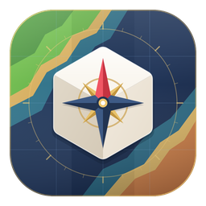

<p align="center">
  
</p>

<p align="center">
  <b>以地图为中心的 Minecraft 启动器</b><br />
  点一张地图，直接落进它的世界。
</p>

<p align="center">
  <a href="LICENSE"></a>
  
  
  
</p>

---

## 这是什么

普通启动器是「先选版本 → 等主菜单 → 挑存档」。Atlas 把顺序反过来：**导入一张地图，它替你建好一个隔离的实例，之后点卡片就直接进图。**

它建立在 [Prism Launcher](https://github.com/PrismLauncher/PrismLauncher)（GPL-3.0，其上游是 PolyMC / MultiMC）的代码之上，但不是它的发行版 —— 见文末[许可与致谢](#许可与致谢)。

## 它解决什么问题

CTM / RPG 地图的痛点是「版本对不上就毁档」：用高版本客户端打开旧存档，Mojang 的 DataFixerUpper 会单向升级存档，**不可逆**。而一张图一个实例又会让硬盘迅速爆掉。

Atlas 的三条硬约束，决定了它的全部设计：

| 约束 | 做法 |
| --- | --- |
| **不坏档** | 版本从 `level.dat` 推断，三级判定给出置信度与证据；判不出来就**拒绝导入**，不猜 |
| **机制还原** | 地图跑在自己的原生版本上（命令方块时序、红石顺序、怪物 AI 都不能翻译） |
| **空间可控** | 每实例只多一份 `--gameDir`，`assets` / `libraries` / `java` 三份资源全局共享 |

## 主要能力

- **一张地图 = 一个实例**：导入 zip / rar / 7z 后自动建实例、只解这一个存档、材质包就地装上，实例之间物理隔离。
- **版本由存档推断**：`Data.Version.Name` / `DataVersion` → 文本旁证 → 结构兜底，冲突按固定顺序裁决，跨主次版本强制人工确认。
- **点开就进图**：1.20+ 走官方 `--quickPlaySingleplayer`，并用 `introskip` 跳过「实验性设置」确认页；1.19.4 及以下走随包的 Java Agent（60 张符号表，覆盖 1.6.1–1.19.4）。
- **退出即关**：确认区块落盘后才结束游戏进程 —— 不是"窗口没了就算退出"。
- **Java 按版本自动选**：1.16.5 及更早 → 8、1.17 → 16、1.18–1.20.4 → 17、1.20.5+ → 21。只在版本对得上的运行时里挑，玩家手选过的实例绝不改写。
- **下载会自己找路**：断点续传、空闲与龟速两道看门狗、镜像 ↔ 官方互备、8 个连接池 + 大文件分片；素材清单按 `assetIndex.sha1` 复用，上游没重发就不重下。
- **地图库与大厅**：CTM Maps 整库本地化（2287 张，离线可搜可看），按**系列 → 地图**两层展示，右键可重命名 / 归类 / 关联站上条目 / 删除；大厅里能直接看出"这张图我本地有没有"。
- **模组预设**：按实例的 MC 版本与加载器现查 Modrinth / CurseForge，自动补依赖，解析不到就标红不下载。
- **导入时可选九项游戏设置**（语言 / 键位 / 全屏 / 云 / 自动跳远 / 视角 / 视野 / 晃动 / 亮度），按版本能力逐项落地。
- **资源库可整体搬到别的盘**，改完立即生效，旧文件按 sha1 认领、不重下。

## 现在能用到什么程度

版本 **0.1.0**，首发版本**尚未发布**。当前状态：

- 构建通过，**33 个测试套件全部通过**（个别用例按本机符号链接权限跳过；基线与耗时只写在
  [`04 §1`](docs/atlas/04-进度与待办.md)）；
- 真机跑通过：1.21.1（Fabric）/ 1.21.9 走 quickPlay，1.8.9 / 1.9.4 / 1.12 Forge / 1.16.5 / 1.19.3 走 Agent；
- 其他版本与部分界面细节仍在验证中。

> 每个数字、每项功能验到哪一档（编译 / 单测 / 真实产物 / 真机），只以
> [`docs/atlas/04-进度与待办.md`](docs/atlas/04-进度与待办.md) 与
> [`docs/atlas/05-验证记录.md`](docs/atlas/05-验证记录.md) 为准。README 不重复维护状态。

### 已知限制

| 限制 | 说明 |
| --- | --- |
| 仅 Windows x64 | 目前没有 Linux / macOS 构建 |
| 1.17 / 1.18 不能自动进图 | 这两个版本没有 `WorldOpenFlows`，只能停在主菜单 |
| 26.x 新布局且无版本号 → 拒绝导入 | 判成低版本等于不可逆降级，宁可拒绝 |
| RAR5 分卷 / 加密头未验证 | 遇到时请转成 zip |
| 大厅依赖第三方站点 | CTM Maps 不可达时降级为纯本地库 |
| 未做代码签名 | SmartScreen 会提示"未知发布者" |
| 需要正版账号 | 不包含、不分发任何 Minecraft 游戏文件 |

## 下载

首发版本尚未发布。发布后**只从本仓库的 [Releases](https://github.com/xwk6661/AtlasLauncher/releases) 下载**：

```
Atlas-<版本>-win64-release.zip    解压即用，无需安装
```

第三方转载的包请勿使用。包内自带 `README-Atlas.txt`（首次使用、数据在哪、已知限制、出问题看哪个日志）与全部许可证文件。

## 从源码构建

需要 Windows + VS2022 + Qt 6.8 + CMake 3.28+。完整步骤见 [`BUILDING.md`](BUILDING.md)。

```powershell
git clone --recursive https://github.com/xwk6661/AtlasLauncher.git
cd AtlasLauncher
Copy-Item CMakeUserPresets.json.example CMakeUserPresets.json   # 改里面的 Qt / vcpkg / JDK 路径
cmake --preset win-local
cmake --build --preset win-local
```

## 文档

**完整索引在 [`docs/atlas/README.md`](docs/atlas/README.md)**（含阅读路径与术语），这里只列入口：

| 文档 | 内容 |
| --- | --- |
| [`BUILDING.md`](BUILDING.md) | 三步构建、跑测试、出便携包（细节全部指向 `docs/atlas/02`） |
| [`CONTRIBUTING.md`](CONTRIBUTING.md) | 怎么提 issue / PR、验证档位要求、代码与提交约定 |
| [`docs/atlas/00-工程约定.md`](docs/atlas/00-工程约定.md) | 文档规则、数字口径、命令行与环境变量、路径事实 |
| [`docs/atlas/`](docs/atlas/README.md) | 设计（01）、构建与运行（02）、决策与坑（03）、进度（04）、验证（05）、变更（06）、发布（07）、真机复看（08） |
| [`CHANGELOG.md`](CHANGELOG.md) | 面向用户的版本变更摘要 |

## 参与

- **问题反馈**：[Issues](https://github.com/xwk6661/AtlasLauncher/issues)（请附日志，模板会提示看哪几个文件）
- **使用问题 / 想法**：[Discussions](https://github.com/xwk6661/AtlasLauncher/discussions)
- **安全漏洞**：见 [`SECURITY.md`](SECURITY.md)，不要开公开 issue

## 许可与致谢

**Atlas 以 [GPL-3.0-only](LICENSE) 发布。**

代码来自 Prism Launcher、PolyMC 与 MultiMC，版权归各自贡献者所有，完整声明见 [`COPYING.md`](COPYING.md)。
第三方组件、数据来源与素材许可逐项列在 [`THIRD-PARTY-NOTICES.md`](THIRD-PARTY-NOTICES.md)；
**完整许可文本在 [`LICENSES/`](LICENSES/README.md)**（Qt 的 LGPL-3.0、图标主题的 Apache-2.0 / OFL-1.1、
各依赖的 copyright 都在里面，随安装包一起分发）。

> **Atlas 是非官方项目**，与 Mojang、Microsoft、Prism Launcher、PolyMC、MultiMC 及 ATLauncher
> 均无隶属关系，也未获其背书。项目不包含任何 Minecraft 游戏文件。
>
> Atlas is an independent project. It is **not** affiliated with, endorsed by, or sponsored by
> Prism Launcher, PolyMC, MultiMC, Mojang or Microsoft. Prism Launcher code is used under GPL-3.0;
> the original authors are credited in [`COPYING.md`](COPYING.md) and the in-app credits.

应用图标自 2026-11-25 起不再沿用上游素材；2026-11-26 换成新的一套（六边形地图瓦片 + 等距立方体 + 罗盘指针）。
原稿是 `program_info/org.atlas.Atlas.png`（1024 RGBA），二进制由 `program_info/genicons.py` 生成；
上一版矢量稿归档在 `program_info/archive/`。品牌素材按 **CC BY-SA 4.0** 授权。

界面图标主题沿用 Prism 的四套，**许可各不相同**：Breeze（KDE，LGPL-3.0+）、
Material（Google，Apache-2.0 / OFL-1.1）、Legacy（MultiMC，Apache-2.0）、Simple（pexner，随 Prism 以 GPL-3.0 分发）；
逐项说明见 [`THIRD-PARTY-NOTICES.md`](THIRD-PARTY-NOTICES.md#品牌与图标)，全文在
[`LICENSES/packages/icon-themes.txt`](LICENSES/packages/icon-themes.txt)。

数据与服务只按公开的只读接口访问，未与任何站点建立正式合作，版权归各站与各作者：
[CTM Maps](https://ctmmaps.com/)（大厅地图资料与评论）、[Modrinth](https://modrinth.com/) 与
[CurseForge](https://www.curseforge.com/)（模组）、[optifine.net](https://optifine.net/)（OptiFine）、
[BMCLAPI](https://bmclapi2.bangbang93.com/)（可选下载镜像）、Mojang 的版本清单与素材。
