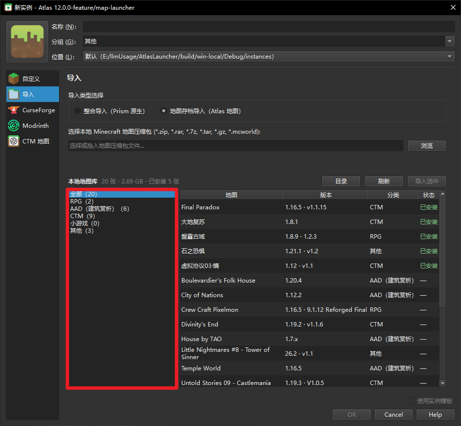
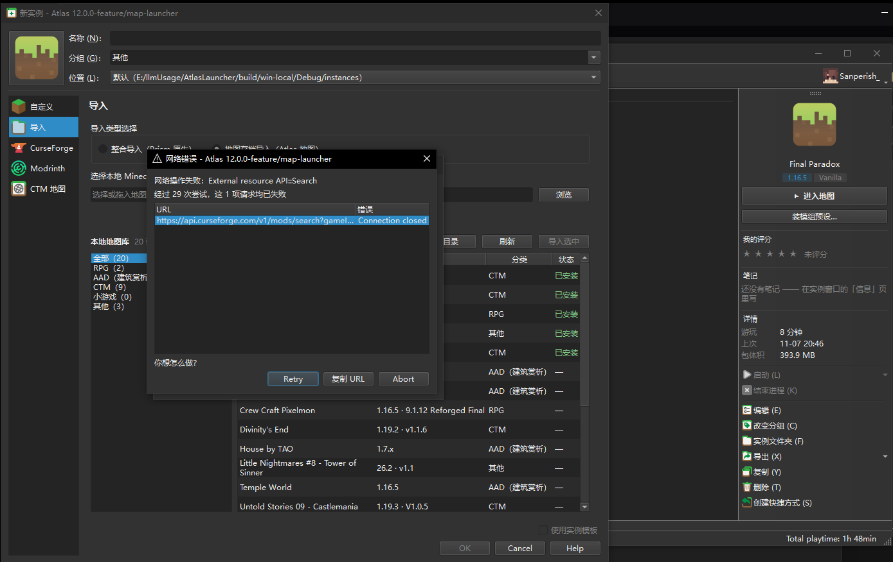

# 05 · 进度与遗留

> **唯一的状态事实来源。** 其它文档不写进度；如果别处与本文件冲突，以本文件为准。
> 最后更新：2026-11-14 19:30（06 §70 的两个资源库 bug **已真机复验**：应用资源库 → 直接启动 →
> 进图，不再重下、不再 `ClassNotFoundException`；同轮复测 31 套件 / 431 项，本机此刻是无符号链接
> 权限口径 418 / 13）

---

## 1. 一句话状态

构建通过 · 测试 **425 passed / 0 failed / 6 skipped**（2026-11-14 00:52 逐套件累加实测，31 个套件共 431 项）·
这 6 项 skip 都是门控用例：需要真实地图 / 网络 / 真实资源包，设对应环境变量才会跑（见 [03](03-环境与构建.md) §5）·
同一套件在**不能建符号链接**的机器上（未开 Windows 开发者模式、且非管理员）会是
**418 passed / 0 failed / 13 skipped** —— 差的 7 项是 `FileSystem_test` 的符号链接用例，
总数永远是 431。**数字对不上先看这一条，别怀疑代码** ·
M0、M2、M5 完成；M1 / M3 / M4 代码已落地，仍有未做项（§2）；M6 主链路完成但**已隐藏**。

真机已验证：1.20+ 点卡片进图与「退出即关」、≤1.19.4 的 Agent 进图与安全落盘退出（1.8.9 / 1.12 Forge /
1.16.5）、大文件分片下载与续传 / 看门狗、本地地图库（分类 / 已安装 / 拖拽 / 自定义分类）与重装可选备份、
资源库换目录（2026-11-14 指向另一个 Prism 数据目录，真机走通并**暴露了两个 bug**，已修，
修复后同日**真机复验通过**：不重下、不 `ClassNotFoundException`，见 [06 §70](06-变更记录.md)）。
Agent 符号表 **60 张**（59 张覆盖 1.6.1–1.19.4，另 1 张 1.21.1 对照），逐槽位对着真实 client jar
校验，矩阵见 [`agent-matrix.md`](agent-matrix.md)。

地图汉化的主链路已通（体检 → 导出 → 自动翻译 → 写回存档 → 旧图备份后顶替 → 恢复原图），
7 张真实地图的数字与参考实现逐项对表通过，详见 [07](07-一键汉化方案.md)；
汉化页已在真实窗口里看过（2026-11-12），仍没有真的替换过一份玩家在用的存档。

**汉化功能已于 2026-11-12 整体隐藏**（`launcher/maps/MapFeatures.h` 里 `kLocalization = false`）：
代码、测试、文档全部保留，界面上「地图 → 汉化」页签与「设置 → 地图 → 汉化翻译」分组都不再出现。
关闭理由见 [06 §63](06-变更记录.md)：字形表（键化图）的图翻不了、写回后没在游戏里验证过显示，
让玩家看到一堆数字反而更糟。恢复只需把那个 bool 改回 `true`。

**已结案的环境问题**：这台机器上曾出现「窗口模式 = 一片白、全屏正常」，2026-11-12 查实
与启动器无关（纯原版命令行同样复现、游戏内 F2 截图正常），**2026-11-13 确认已恢复**，
详见 §6.20。代码侧不再依赖全屏规避，`MapStartFullscreen` 退回纯偏好项。

唯一的现实阻碍是**网络**：Mojang 资源域在部分线路被直接断连、BMCLAPI 的 302 节点多被 TLS 重置。
下载侧七层兜底各自对着一种失败形态，设计见 [02](02-架构与路线图.md) §3.6.3，此处不重复。

| 项 | 值 |
| --- | --- |
| 分支 | `feature/map-launcher`（基于 `develop@6e6f81779`） |
| 产物 | `build/win-local/Debug/atlas.exe`、`LauncherTests.exe` |
| 新代码 | `launcher/maps/` **45 个 .cpp + 51 个 .h，25,767 行**（含汉化 6 个模块对 + `MapOptionsTxt` + 排版层 `MapStyle.h`；汉化已隐藏但照常编译、照常跑测试）；另有 `launcher/ResourcePaths`、`launcher/net/DownloadSource`（换源）；`launcher/net/{Request,FileSink}` 有较大改动（续传 / 看门狗 / 重试 / 连接池 / 分片） |
| 既有文件改动 | 相对 `develop@6e6f81779` 共 **368 个文件**、+49,058 / −4,042（含删除上游 CI 与 nix 文件；2026-11-13 23:40 用 `git diff --shortstat develop...HEAD` 实测）；对既有源码只做加法（见 §4.3） |
| 数据目录 | 便携模式：`build/win-local/Debug/`（`portable.txt`）；资源库已从 `asset/AtlasResources-2026-11-06.zip` 完整恢复（**恢复时** 13,982 文件 / 4.06 GB，`assets` + `libraries` + `java` + `meta` + `metacache`，清单逐条比对通过），`metacache` 与恢复前的条目做过并集（保留 11-06 之后新下的 69 条）。此后又装过新版本；**2026-11-14 资源库已整体迁到 `D:\Games\Minecraft\PrismLauncher`**（assets / libraries / java 三份，跨盘复制后删源），数据目录现在只剩 `meta/`、`metacache`、`instances/`、`maps/` 与旧 `libraries/` 里那次 bug 留下的 53 个残骸文件（已非活跃目录，可删） |
| 大厅本地库 | 1000 张地图 / **2287** 条详情 / 1000 条评论 / 266 个用户名（2.69 MB，抓取于 2026-11-11 12:11Z；`maps/hall-cache.json` 实测） |
| 本地地图库 | `maps/` 目录 **26 个包**、`map-library.json` **23 条索引**（2026-11-12 22:00 统计：CTM 9 / AAD 6 / Other 6 / RPG 2）。三份汉化版包没进索引（§5 1.4）—— 26 − 23 = 3 就是它们；索引 23 条**全部命中磁盘文件**（2026-11-14 19:45 修完改名孤儿后复核）。分类列表是**玩家改过的**（默认 5 类，现存 4 类，`MiniGame` 被删后条目并入 `Other`）—— 文档里的"默认五类"说的是代码默认值，不是这台机器的当前值 |
| 实例 | **10 个**：Bitstream、Final Paradox、Ragecraft III - The Prophecy、Smaller CTM、Terra Restore、Torre de Piedra、Torre de Piedra CN、Torre de Piedra(1)、[SP03] Entropy、盘灵古域（其中 `Torre de Piedra(1)` 实际是 Lacuna Sanctum / **1.21.10**：压缩包名写的是 `[1.21.9]`，但 `level.dat` 的 `Version.Name` 是 1.21.10，判定按精确字段走了后者；目录名是导入时留下的。`Torre de Piedra CN` 是 11-12 汉化实测留下的副本实例） |

---

## 2. 里程碑

| 里程碑 | 内容 | 状态 |
| --- | --- | --- |
| **M0** | 归档嗅探 + 三级版本判定 + `dataversion.json` | ✅ **完成**：23 个 AIO 夹具逐项一致（版本 / 置信度 / 世界数 / 材质包数） |
| **M1** | 导入建实例 + 主界面融入 + ≥1.20 直连 | 🟡 **进图已在真机通过**（1.21.1 quickPlay：点卡片 → 出生点）；带数据包的图原来会先弹「实验性设置」确认，现已加 `introskip` 跳过（**2026-11-03 21:49 真机确认**，见 §5 #18） |
| **M2** | Agent 直连（≤1.19.4）+ 安全退出判定 | ✅ **完成（2026-11-08 真机确认）**：1.8.9、1.12（Forge `[SP03] Entropy`）、1.16.5 均通过实机验证，跳过主菜单秒进地图，Esc 保存并退出后安全秒退回桌面（攻克 Forge 1.12 `TerminalTransformer` 与 `FMLSecurityManager` 退出拦截），`MapQuitWatcher` 外层监听 `EXIT_SAFE` 双保险守护。符号表已从 12 张扩到 **60 张**（59 张覆盖 1.6.1–1.19.4，逐张对着真实 client jar 校验；另 1 张 1.21.1 对照），矩阵见 [`agent-matrix.md`](agent-matrix.md) |
| **M3** | 大厅 + 打磨 | 🟡 搜索/排序/系列·难度·长度·年份筛选/详情 11 项/评论分页/封面真图 + 磁盘缓存/评论卡片/设置页（地图·资源）/**1.20+ 退出即关（✅ 真机连开两次均通过）**；三档瓦片尺寸与快捷键未做 |
| **M4** | 一键装模组预设 | 🟡 代码完成：内置 3 套预设（每条带说明）+ 按实例版本/加载器现查 **Modrinth / CurseForge** + 逐条勾选安装 + **自动装 required 依赖**（取消主条目会连带取消）+ **已安装项标注并默认排除** + 双平台搜索添加 + 自建预设；**差真机复看** |
| **M5** | 本地地图库（分类 / 已安装 / 拖拽归类） | ✅ **完成（2026-11-09 / 11-10 落地并闭环真机反馈）**：`maps/` 20 个包按 `[版本]英文名 版本号 中文名` 整理入库；面板挂在「添加实例 → 导入 → 地图存档导入」下方；拖拽归类、已安装标识、左栏宽度收紧（132px）、CF 搜索静默防阻塞、方案 B 动态自定义分类（增删改 + Other 兜底）以及重装地图可选备份与中文「是/否」对话框全通 |
| **M6** | 地图汉化（体检 / 导出 / 翻译 / 写回 / 顶替 / 恢复）· ⏸ **已隐藏（2026-11-12）** | ✅ **主链路完成（2026-11-11）**：实例「地图 → 汉化」页；7 张真实地图与参考实现对表（Final Paradox 引用数 28747 逐位一致、Torre de Piedra 271 条一致）；C 档写回 9 秒 / 结构差异 0 / 丢弃 0；旧图 63.87 MiB 打包 0.3 秒后顶替。A 档（重建 `resources.zip`）2026-11-12 落地；⬜ 真实 LLM 接口未做，见 [07](07-一键汉化方案.md) §9 |

---

## 3. 下一步（按优先级）

1. **模组预设真机验收**：地图实例 → 右侧「模组预设」→ 选 Fabric 性能 → 确认每行都解析出对应
   版本的条目 → 安装 → 进游戏看模组列表。重点看**未装加载器时的引导**、**解析失败是否标红**、
   **已安装项是否标注并默认不勾**。
2. ~~资源迁移真机验证~~ ✅ **2026-11-14 真机走过**（指向 `D:\Games\Minecraft\PrismLauncher`），
   迁移本身完成（12,721 / 803 / 996 个文件），但同时暴露两个 bug（classpath 不认共享目录、
   下载账本没跟着走），已修，见 [06 §70](06-变更记录.md)。**修完已复验（2026-11-14 19:30）**：
   「应用资源库 → 直接启动（不重启）→ 进图」走通，不再下载、也不再 `ClassNotFoundException`。
3. **RAR5 大包**：分卷 / 加密头（夹具里只有小 RAR）。
4. **导入流程的加载器版本选择器**：目前只能手填，或导入后到实例「版本」页装。
5. **「换源」建议**：启动失败时除了 Retry，再给一个「改用 XX 源重试」按钮（见 §5 #20）。
6. **地图汉化：⏸ 暂停**（功能已整体隐藏，`kLocalization = false`；代码、测试、文档全留）。恢复时再补：
   - ⬜ **真实 LLM 接口实测**：开发环境没有 key，只覆盖了「模型输出解析」的容错；
   - ⬜ **写回后进游戏确认显示**：结构比对只能保证"没写坏"，没有一次「替换 → 启动 → 看到中文」的闭环（§6.19）；
   - ⬜ 家族与碎片组折叠、多世界实例只换主世界、体检结果不落盘 / 串行扫描（§5 #24–#26）。
   A 档（重建 `resources.zip`）与「界面在真实窗口点过」**已不在欠账里** —— 分别在
   [06 §62](06-变更记录.md) 与 [06 §61](06-变更记录.md) 完成。

> **已完成的不再占位**：分段下载 / 断点续传 / 空闲与吞吐看门狗 / 镜像↔官方双向回落、Agent 真机验收、
> 符号表 60 张全量校正、解压异步化与启动期磁盘清理、本地离线优先、进度对话框打磨、
> Forge / OptiFine 兼容修复、introskip 跳过「实验性设置」页 —— 逐条过程与结论见
> [06](06-变更记录.md)（§18、§29–§53）。
>
> **已排除**：视角锁死 / 狂转 —— 成因是远程控制软件（ToDesk / 向日葵），断开即正常，与启动器无关
> （[06](06-变更记录.md) §17）。

---

## 4. 代码清单

### 4.1 新增（`launcher/maps/`）

| 文件 | 职责 |
| --- | --- |
| `MapTypes.h` | Confidence / LevelDatFacts（含 `requiredMods`）/ MapLayoutFacts / VersionGuess |
| `MapTextUtils.{h,cpp}` | 剥 § 格式化码、GBK 回退解码、版本号抠取、游玩时长格式化 |
| `DataVersionTable.{h,cpp}` | 483 个版本 / 481 条 DataVersion 双向索引、Java 大版本、quickPlay 判定 |
| `LevelDatReader.{h,cpp}` | level.dat（GZip + NBT）→ 版本字段 / BorderSize / ServerBrands / `FML LoadingModList` |
| `MapVersionDetector.{h,cpp}` | 三级判定 + 冲突裁决 + 26.x 拒绝猜测 |
| `MapArchiveScanner.{h,cpp}` | 免解压嗅探：世界根、结构特征、材质包 / 模组 / 说明文件 |
| `MapMeta.{h,cpp}` | `map.json` 唯一读写点：证据链、世界列表、统计、模组清单 |
| `MapNotes.{h,cpp}` | `notes.json`：中文名 / 评分（半星）/ 笔记。与 `map.json` 分文件 |
| `MapImportTask.{h,cpp}` | 建实例 → 解世界（线程池异步化 + 支持中途取消）→ 落材质包 / 模组 → 合并 `options.txt` → 写 `map.json`；`MapReinstallTask` 异步重装（支持勾选备份至 `saves/.mcml-backup/<时间戳>/` 或直接重装，且提供中文「是/否」对话框） |
| `MapDiskCleanup.{h,cpp}` | 启动期与常规磁盘碎片清理：清理 `.part.parallel`、`.part-*`、过期 `.part` 及 `instances/.tmp/*` 孤儿目录 |
| `MapRepository.{h,cpp}` | 实例列表 → 地图列表（判据：有 `map.json`）、地图库归档与路径回退 |
| `MapLibrary.{h,cpp}` | 本地地图库模型：`map-library.json` 读写（文件名做键、原子写）、默认纯英文分类（RPG / AAD / CTM / MiniGame / Other）与方案 B 自定义分类增删改、目录扫描、按实例引用算「已安装」、导入后补元数据 |
| `MapLibraryPanel.{h,cpp}` | 库面板：分类栏（固定宽度 132px 防截断，带 `+`/`-` 按钮与右键分类管理）+ 列表、拖行到分类即归类、双击/按钮走现有导入链路、打开库目录/刷新 |
| `MapLaunchPrep.{h,cpp}` | 只认 trait 选轨道、可指定世界、退出后按 `agent.log` 回写统计；`prepareForLaunch()` 是所有启动入口的唯一准备点，启动前顺带修一次 `options.txt` |
| `AgentBootstrap.{h,cpp}` | 符号表 → `k=v,k=v`、注入（运行时属性 `mapsJavaAgents`，不碰用户 `JvmArgs`）、事件解析与日志监听 |
| `MapHallLink.{h,cpp}` | 实例 ↔ CTM 地图关联（`hall-link.json`），删文件即解除 |
| `HallCache.{h,cpp}` | 大厅本地库：4 个接口的原始行 → `hall-cache.json`（原子写）；`detailsCoverList` 判完整性 |
| `HallAPI.{h,cpp}` + `HallTypes.h` | 搜索 / 详情 / 筛选 / 评论分页 / 用户名补全 / 失败分类 / 整库同步 |
| `HallProxy.{h,cpp}` | 出口解析：环境变量 → 本地端口扫描 → 系统代理 → 直连；`shouldBypassProxy` |
| `BrowserFetch.{h,cpp}` | 浏览器通道：本地页面 + XHR + 退避重试 + base64 回传 |
| `MapCoverLoader.{h,cpp}` | 封面：直连失败切无头浏览器批量取图 + 内存 LRU + 磁盘缓存 + 占位封面 |
| `MapImportDialog.{h,cpp}` | 名称 / 世界 / 版本 / 加载器 + 证据 + 置信度红条 + 缺模组提示 |
| `MapHallPage.{h,cpp}` | 「添加实例 → CTM 地图」页：搜索 / 排序 / 四个筛选 / 封面列表 / 详情三页签 |
| `HallDialog.{h,cpp}` | 独立大厅对话框（菜单入口）：搜索 + 表格 + 详情 + 评论 |
| `MapInstanceBar.{h,cpp}` | 右侧操作栏地图卡片：中文名 / 徽章（居中）/ 评分 / 笔记 / 详情（游玩·上次·包体积，关联 CTM 后加作者·系列）/ 世界下拉 / 主按钮 |
| `MapInstancePage.{h,cpp}` | 实例窗口「地图」页（原「信息」，置顶且为默认页）：简介 / 评论 / 我的 / 启动（四页签；启动页装的是实例级地图启动设置，原「设置 → 地图」；汉化页随 `kLocalization` 隐藏，见下面 `MapL10n*`） |
| `MapL10nProbe.{h,cpp}` | 汉化只读体检：`.mca` 扇区读 + 剪枝遍历（1.5 ms/区块）+ 文本载体白名单（含 1.8 的 `Text1–4`、`pages`、`Command` 里的 JSON）+ 散文判定（排除已含中文）+ 语言表读取 + 结构比对工具 |
| `MapL10nTask.{h,cpp}` | 体检任务宿主：`executeTask()` 只派活到线程池，进度与取消走 `invokeMethod` 回主线程 |
| `MapL10nExport.{h,cpp}` | 导出待译清单：`strings.json`（结构化）+ `strings.csv`（UTF-8 带 BOM，Excel 直接填） |
| `MapL10nTranslate.{h,cpp}` | OpenAI 兼容接口批量翻译：异步串行、批间不并发、译文就地写回 `strings.json`、失败保留已翻部分 |
| `MapL10nApply.{h,cpp}` | **A 档**只改资源包（`applyToPack`：写 `zh_cn.json`、整包重写、原包先备份）；**C 档**写回存档（未改区块搬原始压缩字节、改过的区块过结构比对、旧存档打包 zip、汉化版顶替）；**从备份还原**（`listBackups` / `restoreWorldFromBackup` / `MapL10nRestoreTask`） |
| `MapOptionsTxt.{h,cpp}` | `options.txt`：导入时写语言 / 键位 / 全屏（1.13 前后两代写法，判不出代就一条都不写）；补 `version:<DataVersion>`（缺了游戏会整份丢弃设置）与 `onboardAccessibility`；`repairOptionsTxt` 供启动前自愈 |
| `MapReviewCard.{h,cpp}` | 评论卡片（大厅与「地图」页共用） |
| `MapInfoCard.{h,cpp}` | 信息卡片工厂（`makeCard` / `makeKeyLabel` / `clearLayout`），大厅详情与「地图」页共用 |
| `MapGalleryPage/Window.{h,cpp}` | 画廊（次要入口，仅独立窗口） |
| `ModPresets.{h,cpp}` | 模组预设：`mod-presets.json` 读写 + 内置三套 + `ModPresetResolveTask`（Modrinth / CurseForge 逐条查版本，release 优先，递归 required 依赖，批量补依赖名）+ `ModSearchTask` |
| `ModPresetDialog.{h,cpp}` | 预设选择/安装（勾选、说明列、依赖行、自己挑…）+ 预设编辑（一行一个模组，支持 `cf:<id>`） |
| `ModSearchDialog.{h,cpp}` | 双平台搜索添加（Modrinth / CurseForge，多选） |
| `MapSettingsWidget.{h,cpp}` | 地图设置内容体：自动进图 / 退出即关 / 跳过实验性确认 / 进图延迟（实例作用域挂在「地图 → 启动」页）+ 地图库 / 大厅 / 控制台页签（仅全局，挂在全局「地图」页） |
| `MapPage.h` | 全局设置的「地图」页（排在「常规」右边） |
| `MapQuitWatcher.{h,cpp}` | 1.20+ 轨道：盯游戏日志（离开存档 → 全部落盘）后关游戏窗口；300ms 核对一次「连的还是不是当前 `LaunchTask`」 |
| `MapWindowFocus.{h,cpp}` | 启动后把前台交给游戏窗口 —— 针对 quickPlay 在「窗口无焦点」时抓不住鼠标的已知缺陷（MCL-24083）的兜底；与本次的视角问题无关（那是远控软件） |
| `net/DownloadMonitor.{h,cpp}` | 旁路观测：正在跑的 NetJob 聚合成快照（整体/单文件速度、活跃文件），供进度面板轮询 |
| `ui/widgets/DownloadPanel.{h,cpp}` | 下载面板：`下载中 · 已收 X · Y/s · 文件 n/m` + 每行「文件名 / 进度 / 大小 / 速度 / ×N 段」 |
| `ResourceStore.{h,cpp}` | 资源库迁移：assets / libraries / java 搬到指定目录（同盘改名，跨盘复制后删源） |
| `MapResourcePage.{h,cpp}` | 全局设置的「资源」页：选择目录 / 检测本机已有资源 / 一键迁移 |
| `OptiFineDialog.{h,cpp}` | 安装 OptiFine（版本页入口），BMCLAPI → 官网双源 |
| `StarRatingWidget.{h,cpp}` | 星级控件（只读给卡片，可编辑给「我的」） |
| `MapTheme.h` | 主题色与卡片样式（不写死颜色） |
| `MapStyle.h` | 排版层（header-only）：间距五档、页面边距 12、字体三层（页标题 / 卡片标题 / 次要信息）、卡片与分隔线、主次按钮、表格与空态。**只放尺度，颜色仍由 `MapTheme.h` 按 palette 出**（06 §66） |
| `MapFeatures.h` | 功能开关：`maps::features::kLocalization`（汉化界面入口，当前 `false`）。**只控制界面是否出现**，代码与测试照常编译、照常跑；恢复功能只改这一个 bool |

### 4.2 新增（资源与测试）

| 路径 | 内容 |
| --- | --- |
| `launcher/resources/maps/` | `dataversion.json`（483 版本）+ `maps.qrc` |
| `launcher/resources/agents/` | `quickboot.jar`（ASM 已 shade）+ `introskip.jar` + **60 张符号表** + `agents.qrc`（由审计脚本按目录重写） |
| `launcher/ResourcePaths.{h,cpp}` | assets / libraries / java 的绝对路径解析（共享目录优先，见 [02](02-架构与路线图.md) §2.3） |
| `tests/MapArchiveScan_test.cpp` | 17 项常规测试（含磁盘清理、旁证来源名 UTF-8、随包符号表逐张可拼参数） + 2 项联网用例（默认 skip） |
| `tests/ModPresets_test.cpp` | 14 项：内置预设合法性、加载器匹配、双平台搜索响应解析 |
| `tests/DownloadSource_test.cpp` | 12 项：镜像映射表逐条、不该映射的域、幂等、显式选源 |
| `tests/RequestRetry_test.cpp` | 23 项：错误分类表、`FileSink` 重入/abort 后的写入语义、校验器重置、假网络下的「302 → 节点断连 → 回到入口」全链路、重试预算、官方源重试、传输超时重试、停滞错误可读、镜像→官方回落单向、切分连续性、乱序写入、校验失败不落盘、**断点续传 / 服务器无视 Range / 校验器补喂 / 分片预分配隔离 / 官方→镜像回落** |
| `launcher/ui/dialogs/ImportChoiceDialog.{h,cpp}` | 拖拽压缩包时的导入模式抉择对话框（整合 vs 地图存档，带智能特征探测）（§45） |
| `launcher/resources/agents/introskip.jar` | 1.20+ 跳过「实验性设置」确认页的 Java Agent（ASM 已重定位到 `atlas/introskip/shaded/asm`） |
| `launcher/resources/agents/introskip.json` | 13 个版本（1.20–1.21.5）的 `WorldOpenFlows.askForBackup` 混淆签名 + `loadLevel` 槽位 |
| `tools/introskip-agent/` | 上面两个文件的源码与构建脚本（`build.sh` / `gen_table.py` / `relocate/`） |
| `tools/agent_symbol_audit.py` | 符号表审计与生成：`audit` 模式逐槽位对着真实 client jar 复核；`generate` 模式为缺表版本生成（1.14.4+ 拉官方 `client_mappings`，更早走字节码指纹），落盘前独立复核；`--sync-qrc` 按目录重写 `agents.qrc`；`--report` 输出覆盖矩阵 |
| `tools/map_library_scan.py` | **只读**盘点一个目录里的地图包：7z 列目录 → 只抽 `level.dat` → NBT 读版本/存档名，输出体积、sha1、世界数与重复项（整理前的体检） |
| `tools/map_library_migrate.py` | 存量整理：按 `[版本]英文名 版本号 中文名` 改名（幂等）、写 `map-library.json`、修正实例 `map.json` 的库引用；`--dry-run` 先看计划，改名记录落 `build/map-library-rename.json` |
| `docs/atlas/agent-matrix.md` | 由上面脚本生成的覆盖矩阵：哪 60 个版本有表、每张表什么来源、哪 20 个版本不能自动进图以及确切原因 |

### 4.3 改动的既有文件

| 文件 | 改了什么 |
| --- | --- |
| `launcher/CMakeLists.txt` | `MAPS_SOURCES` + 两个 qrc + `MapWindowFocus` |
| `launcher/Application.cpp` | 地图设置项 + 资源库设置项 + `launch()` 里的统一准备点（`MapLaunchPrep` / `MapQuitWatcher` / `MapWindowFocus`） |
| `launcher/minecraft/MinecraftInstance.cpp` | `processMinecraftArgs` 读 `JoinWorldOnLaunch`；启动脚本已写 `worldName` 时不再重复拼 `--quickPlaySingleplayer` |
| `launcher/tasks/Task.cpp` | 三处 `ASSERT_NEVER(!isRunning())` 改普通守卫（Debug 下 `qFatal` 会把启动失败升级成整个启动器退出） |
| `launcher/java/JavaChecker.cpp` | 被 15s 超时杀掉但 stdout 已有 `java.version` 时按有效结果继续，不再误判「起不了 java」 |
| `launcher/settings/INISettingsObject.{h,cpp}`、`SettingsObject.h` | `suspendSave` 从 `bool` 改计数器（`SettingsObject::Lock` 是 RAII，嵌套加锁合法） |
| `launcher/ui/MainWindow.{h,cpp}` | 操作栏接线（含地图卡片出现时把原生「编辑」从工具栏摘掉、非地图实例插回）、菜单、拖放弹 `ImportChoiceDialog` 分流（§45）、后台更新大厅 |
| `launcher/ui/dialogs/NewInstanceDialog.{h,cpp}` | 支持 `initialPage`；精简来源页 |
| `launcher/ui/pages/modplatform/ImportPage.{h,cpp,ui}` | 整合与地图存档双轨模式切换、解耦任务派发、智能提示与一键模式切换、直接拖拽支持（§45） |
| `launcher/InstancePageProvider.h` | 页签重排（**地图置顶**、设置第二）+ 地图页 |
| `launcher/ui/pages/instance/InstanceSettingsPage.{h,cpp}` | 去掉「地图」页签（实例级启动设置已移到实例窗口「地图 → 启动」，保存责任一并搬走） |
| `launcher/ui/InstanceWindow.cpp` | 默认停在「地图」（原「设置」；非地图实例自动回落到设置） |
| `launcher/archive/ArchiveReader.{h,cpp}`、`ArchiveWriter.cpp` | `File::size()`；修 2 处上游编译错误 |
| `launcher/tasks/{Sequential,Concurrent}Task.cpp` | 修 Debug 断言崩溃 |
| `launcher/ui/pages/instance/WorldListPage.cpp` | 地图实例的世界列表只读 |
| `launcher/launch/LaunchTask.{h,cpp}` | 新增 `gameLogLine` 信号（逐行日志，给退出看门狗用） |
| `launcher/minecraft/AssetsUtils.cpp`、`update/AssetUpdateTask.cpp` | 资产/索引路径改走 `ResourcePaths` |
| `launcher/net/Request.{h,cpp}` | 镜像换节点重试（回到入口、最多 3 次、只认连接错误与 GET）+ `Option::NoMirrorRetry`；把 `APPLICATION` 改成 `APPLICATION_DYN`；分片断点续传与减半段数重试（§43） |
| `launcher/net/FileSink.{h,cpp}` | `init()` 重入时先 `cancelWriting()` 掉上一轮；目标文件 `.part` 归属表防争抢（§41）；校验失败与改名失败时释放占用（§44） |
| `launcher/net/DownloadMonitor.{h,cpp}` | 旁路聚合下载快照；按活跃项正向增量累加计算瞬时速率，消除单文件完成移出列表导致的跳 0 缺陷（§44） |
| `launcher/ResourcePaths.{h,cpp}`、`maps/HallCache.cpp`、`maps/ResourceStore.cpp`、`maps/ModPresets.cpp` | 数据/路径模块改走 `APPLICATION_DYN`，保障无 GUI 单测与后台调用的健壮性（§44） |
| `launcher/maps/MapArchiveScanner.cpp` | 归档路径多重前缀规范化（剥离 `./`、`/`、`\`），避免异常压缩包结构引发解压路径偏移（§44） |
| `launcher/net/NetJob.{h,cpp}` | 构造/析构登记到 `DownloadMonitor`；新增 `activeDownloads()` / `doneCount()` 供下载面板取快照 |
| `launcher/ui/dialogs/ProgressDialog.{h,cpp}` | 内嵌下载面板、总进度条改「n / m 个文件（%）」、右上角显示总速度、下载时隐藏步骤条 |
| `launcher/ui/pages/global/LauncherPage.ui` | 分片数的说明文案更新（默认 16 段、可调到 32） |
| `launcher/ui/dialogs/DownloadSourceTestDialog.cpp` | 连通性测试带 `NoMirrorRetry`，避免"自带 5 次"被叠成 20 次 |
| `launcher/ui/pages/global/MinecraftPage.h` | 页名 `Minecraft` → **游戏** |
| `launcher/minecraft/Library.cpp` | classpath 前缀改走 `resource::librariesDir()`（原来返回相对 `"libraries/"`）；库文件缺失但本地已有同名文件时按 sha1 认领，不再重下（[06 §70](06-变更记录.md)） |
| `launcher/net/HttpMetaCache.{h,cpp}` | 新增 `setBase()`：覆盖基址并把该基址下每条记录的绝对路径一起改；`Load()` 补上 `m_basePath` |
| `launcher/Application.{h,cpp}` | 新增 `refreshResourcePaths()`，供「应用资源库」/「确定」后同步 metacache 基址 |
| `launcher/maps/MapResourcePage.cpp` | 迁移后与改路径后同步基址；文案去掉「需重启」（[06 §70](06-变更记录.md)） |

---

## 5. 还剩什么（诚实清单）

| # | 事项 | 说明 |
| --- | --- | --- |
| 1 | RAR5 大包 | 分卷 / 加密头未测 |
| 1.1 | ~~地图库真机反馈问题~~ | ✅ **已解决（2026-11-09 / 11-10）**：① 分类栏固定 132px，分类与状态列自适应不截断；② CF 搜索关闭阻塞弹窗并设单次尝试；③ 分类名纯英文短名，方案 B 实现动态自定义增删改与 Other 转移兜底；④ 重装地图支持可选备份与中文「是/否」对话框（见 **§8**） |
| 1.2 | **`Smaller CTM` 实例缺备份压缩包** | `map.json` 的 `libraryCopy` 指向 `<数据目录>/maps/Smaller CTM.rar`（库里没有），`path` 指向换机器前的 `D:/Games/PrismLauncher/instances/[1.12.2]SP03/minecraft/saves/Smaller CTM.rar`；2026-11-14 19:30 复查两处仍都 `exists=False`，重装会缺源，需要玩家把包放回库目录 |
| 1.3 | 库里的中文名有 12 张是空的 | 命名整理只采用有证据的中文名（文件名 / notes.json）；`Divinity's End`、`Final Paradox` 这类保持英文，可在 `map-library.json` 里补。**2026-11-14 19:30 复查**：23 条索引里仍是 12 条 `chineseName` 为空 |
| 1.4 | 库目录里有三份汉化包没进索引 | `[1.16.5]Bitstream World 1.16.5（简中汉化v1.0）.zip`、`[1.16.5]Crew Craft Pixelmon 9.1.12 Reforged Final（简中汉化v1.0）.zip`、`[1.21.9]Untold Stories - Lacuna Sanctum - MC1.21.9（简中汉化v1.0）.zip` 在 `maps/` 里但不在 `map-library.json`，也没有实例引用。要么在界面上补录，要么明确当参考素材放着 —— 不补录时刷新会把它们当孤儿，不显示也不会删。另外两份汉化包（`Mapwreck VII`、`Torre de Piedra`）**已在索引里**，所以是 3 份不是 5 份 |
| 1.5 | ~~按主题改过名的两个包，索引没跟上~~ | ✅ **已修（2026-11-14 19:45）**：`Ragecraft III` 的两个包在资源管理器里被改成 `[1.8.9]Ragecraft III - The Prophecy.zip` / `… （繁中）.rar`，索引仍指旧名。已把两条 `file` 改成磁盘上的新名（先核对体积与 `bytes` 一致），实例 `Ragecraft III - The Prophecy` 的 `archive.path` / `libraryCopy` 同步指过去，备份 `map-library.json.bak-20261114-194556`。修完索引 23 条全部命中磁盘文件。**这个坑本身还在**：以后手动改名仍会产生孤儿，见 §6.18 |
| 2 | 导入流程的加载器版本选择器 | 目前手填 |
| 3 | ~~模组套件~~ | ✅ 已做（M4）：自带 3 套预设 + 双平台搜索 + 依赖自动安装；AIO 那 4 套没有逐条搬，玩家可自建 |
| 4 | 符号表覆盖 | **59 个版本（1.6.1–1.19.4 全量）**，每张都对着真实 jar 校验过；仍有 20 个版本没有表：1.0–1.2.5（无集成服务端）、1.3–1.5.2（主菜单构建方法有多个同签名候选）、1.14–1.14.3（早于官方 `client_mappings`，结构上 3 个 setScreen / 14 个 `(Z)V` 候选）。缺表时降级「停在主菜单 + 提示」，不猜。原因逐条见 [`agent-matrix.md`](agent-matrix.md) |
| 5 | ~~地图解压仍是同步的~~ | ✅ **已做（2026-11-07）**：`MapImportTask` / `MapReinstallTask` 已搬到 `QtConcurrent` 线程池，支持中途取消与回滚（[06](06-变更记录.md) §46）；这条描述停留在 11-05 的状态，已过期 |
| 6 | `map.json` 的 `archive.sha1` 恒空 | 导入时不额外读整包（大包多花 10 秒不值） |
| 7 | ~~Agent 参数落在 `JvmArgs` 上~~ | ✅ 已改：参数放实例的运行时属性 `mapsJavaAgents`，由 `MinecraftInstance::extraArguments()` 追加，不落盘、不碰用户的 `JvmArgs`。原写法因 `OverrideJavaArgs` 语义**从未生效**（2026-11-03 真机查实） |
| 8 | UI 文案的中文写在 `tr()` 源串里 | 切英文仍显示中文；国际化要先改源串再补 `.ts` |
| 9 | `ctmrepository.com` 的 50 张封面取不到 | Cloudflare 不认无头浏览器；其余 874 张 supabase 正常 |
| 10 | 首次打开大厅要等约 12 秒 | 一个无头进程一批取 8 张，20 行要 3 批；之后磁盘命中 |
| 11 | 封面缓存无上限、无清理入口 | 单张约 20 KB；要加就在「设置 → 地图」加「清空封面缓存」 |
| 12 | 筛选是单选 | 站上难度/长度可多选；`HallQuery` 已支持列表，改 UI 即可 |
| 13 | 没有版本筛选 | 需要动 `HallQuery` 与 PostgREST 查询，超出"小改"范围 |
| 14 | 三档瓦片尺寸、快捷键 | M3 里明确未做 |
| 15 | **资源迁移** | ✅ **真机走过（2026-11-14）**，同时暴露并修掉两个 bug（[06 §70](06-变更记录.md)）：classpath 走的是相对 `libraries/`（不认共享目录）→ 客户端 `ClassNotFoundException`；换库后下载账本基址没跟着走 → 条目被除名、整份重下。迁移本身（跨盘复制 12,721 / 803 / 996 个文件）没问题；**修完已复验**（应用 → 不重启直接启动 → 进图，不重下） |
| 16 | ~~资源位置改完要重启启动器~~ | ✅ **不再需要（2026-11-14）**：`Application::refreshResourcePaths()` 在「应用资源库」/「确定」后同步 metacache 基址，下载与 classpath 当次就指向新目录 |
| 17 | 1.20+ 的退出判定依赖两句英文日志 | 服务端日志不受客户端语言影响；但换版本/装改日志的模组时要复核 |
| 18 | **「实验性设置」确认页** | ✅ **真机确认**（2026-11-03 21:49）：`introskip` 把 `WorldOpenFlows.askForBackup` 改成直接执行 `loadLevel`，客户端日志 `已跳过确认页` 后 3 秒进图。世界数据、数据包、`level.dat` 一律不动。设置项 `MapSkipExperimentalPrompt`（默认开，可被实例覆盖）。日志：`<数据目录>/agents/introskip-<hash>.log`（**纯 ASCII 路径**，实例目录名含非 GBK 字符时也能写）。版本表覆盖 1.20–1.21.5，新版本需重跑 `gen_table.py` |
| 19 | ~~下载源只有官方~~ | ✅ **已做**（2026-11-04）：设置 → API 顶部「下载源」可选 BMCLAPI 镜像，覆盖资源 / 库 / 版本 json / 运行时清单，镜像请求直连不走代理；默认仍是官方，官方路径一个字节没改。镜像模式下「资源服务器」由镜像接管，旁边有「测试连通性…」。见 [06](06-变更记录.md) §26、§27 |
| 20 | 启动失败时的提示 | 单个请求的失败原因已改成能看懂的话（「网络停滞：长时间收不到数据（已重试 3 次）」而不是 `Operation canceled`），但**任务级弹窗**仍是「n 项请求失败 + 一串 URL + Retry」。剩：直接给「改用 XX 源重试」按钮（[06](06-变更记录.md) §30） |
| 21 | ~~汉化：A 档（资源包）未实现~~ | ✅ **已实现（2026-11-12）**：`applyToPack` 写 `zh_cn.json` 并整包重写，原包先备份；`Mode::Key` 的图不再白改存档。Final Paradox 167 MB 实测通过。见 [06 §62](06-变更记录.md) |
| 22 | **汉化：真实 LLM 接口没跑过** | 开发环境没有 key。已覆盖的只有「模型输出解析」的容错（围栏、客套话、非法条目） |
| 23 | ~~汉化：界面没在真实窗口点过~~ | ✅ **已做过（2026-11-12）**：汉化页版面在真实窗口里截图确认，四个按钮与三段弹窗都看过一遍（[06 §61](06-变更记录.md)）。功能随后整体隐藏 |
| 24 | **汉化：家族与碎片组没折叠** | 打字机动画一帧一条会逐条进清单（白花翻译量）；被拆成多段的同一句不整组送翻，中文语序会乱 |
| 25 | **汉化：多世界实例只换主世界** | `worlds.at(0)`。地图合集类的图需要再扩成按世界逐个替换 |
| 26 | **汉化：体检结果不落盘、串行扫描** | 切走页签就丢，重扫一次即可；691 MB 的图约 2 分钟（写回只要 9 秒，瓶颈在体检不在改） |
| 27 | ~~`options.txt` 缺 `version:` 导致整份设置作废、quickPlay 被无障碍引导挡住~~ | ✅ **已修（2026-11-12）**：写的时候补 `version:`、启动前自愈、只在"没被游戏读过"时补回中文与键位；地图实例写 `onboardAccessibility:false`。见 [06 §61](06-变更记录.md) |
| 28 | ~~窗口模式一片白（环境问题，非启动器）~~ | ✅ **已恢复（2026-11-13 确认）**：曾表现为窗口化 GL 呈现全白、F2 截图正常、全屏正常，纯原版命令行同样复现，因此判定为机器侧问题（RTSS / 虚拟显示驱动 / 驱动版本）。现已正常，`MapStartFullscreen` 不再是规避手段，只是地图实例的默认偏好。细节见 §6.20 |
| 29 | **汉化整体隐藏（2026-11-12）** | 功能本身可用但"效果不行"：字形表的图翻不了、写回后没在游戏里验证过显示。界面入口已摘掉（`MapFeatures.h` 的 `kLocalization = false`），代码 / 测试 / 文档全留。#20–#26 这些汉化遗留项**暂时不用管**，恢复功能时一并处理。见 [06 §63](06-变更记录.md) |

---

## 6. 未验证 / 已知未知

1. **Prism 的 meta 是否给所有 1.20+ 版本都带 `feature:is_quick_play_singleplayer` trait** ——
   代码按 trait 判断（不写死版本号），但没实机验证 1.20.2 / 1.21.x 全量。
   （冷启动 traits 为空时现在有版本表兜底，见 [06](06-变更记录.md) §50。）
2. **libarchive 对 RAR5 / 加密头 / 分卷的真实边界** —— 夹具里的 RAR 能扫，大包没测。
3. **Agent 与 Forge 的 FML ClassLoader 冲突** —— 已照 AIO 的解法实现（参数落系统属性 + 自写日志），
   但**没有 1.12.2 + Forge 的资产可测**。
   另：**59 张表里只有 1.8.9 / 1.12 / 1.16.5 上过真机**，其余（含重新生成的 1.7.10 与
   1.6–1.13 的指纹表）只到「每个槽位都能在真实 jar 里查到」这一步，没有启动过游戏。
4. **AIO 的 8 张真实地图**在 `E:/llmUsage/Minecraft-AIO/launcher/env/profiles/*.json`；
   M0 回归用的是 `launcher/fixtures/` 的 23 个夹具（更全且带期望值）。
5. **封面仍有一类取不到**：`ctmrepository.com` 的 50 张（Cloudflare），已确认不是代码问题。
6. **便携模式下 `build` 目录即数据目录**：clean 会连玩家数据一起删。
   6.1 ~~被中断的导入会留下 `instances/.tmp/<6位key>`~~：✅ **已解决（2026-11-07）**：已由 `MapDiskCleanup::cleanAsync` 在启动期异步清理孤儿临时目录（[06](06-变更记录.md) §46）。
   6.2 **大包解压在 Debug 版下很慢**（162 MB / 约 700 个 region 要 3–5 分钟）：Release 会快很多，别把 Debug 的耗时当产品性能。
7. **资源迁移的跨盘行为**：✅ 2026-11-14 真机跨盘搬过（assets 12,721 / libraries 803 / java 996 个
   文件），复制完整性确认，顺带查出并修掉两个 bug（[06 §70](06-变更记录.md)）。**仍未验证**的只有
   「旧目录删除失败」的回退提示 —— 那次删除是成功的，异常分支没被走到。
8. **网络环境差异，不是代码错**：官方域在部分线路被 TLS 重置（2026-11-04 同机实测：官方
   `Connection closed`、BMCLAPI 直连 200），所以有换源开关（§5 #19）。重试 / 回落的策略写在
   [02 §3.6.3](02-架构与路线图.md) 与 [04 §5](04-踩坑与决策.md)，这里只留"现场长什么样"。
   8.1 **镜像本身也不稳定**：BMCLAPI 302 到随机节点，单次成功率仅 30–50%；被掐的是被指到的那台节点
   （`*.sakura.*` 直接 TLS 重置），偶尔抽到 USTC 节点就有 1.3 MB/s —— "镜像全红、官方绿"是节点抽签，
   不是映射表错（[06](06-变更记录.md) §30）。
   8.2 **带宽按连接分配**：同一文件 1 条 60 KB/s、8 条 487 KB/s、32 条 1.19 MB/s；Qt 一个 QNAM 每主机
   只开 6 条，所以调并发数没用，改用 8 个 QNAM 的池（48 条）（[06](06-变更记录.md) §31、§41）。
   8.3 **官方 CDN 自己在摆**：`libraries.minecraft.net` 同一时段 30 KB/s ~ 1.2 MB/s。看到"只有 60 KB/s"
   先量一下再怀疑启动器。
   8.4 **"卡住"有三种形态**：用户看到的一样、日志不一样 —— ① 连接被掐（`Connection closed`，靠续传）；
   ② 死连接（无日志，靠 20 秒空闲看门狗）；③ 龟速（靠 10 秒吞吐窗口）。排查先看
   `Resuming` / `No response in` / `crawling` 落在哪个（[06](06-变更记录.md) §36–§38）。
9. ✅ **复用外来资源库不再整份重下（2026-11-14）**：`Library::getDownloads()` 加了一条「认领」路径 ——
   条目缺失、但目标位置已有同名文件时，按元数据里的 sha1 核对内容，对得上就给 `metacache`
   补记录（md5 + 时间戳）并跳过下载。所以从官方启动器 / 另一台机器拿来的 `libraries/`
   现在是「校验一遍」而不是「重下 2 GB」。代价是这一轮要读一遍文件（按需，只有用到的那几个版本）。
   见 [06 §70](06-变更记录.md) 与 [03](03-环境与构建.md) §6.2。
10. ~~`.part` 残留没有自动清理~~：✅ **已解决（2026-11-07）**：已由 `MapDiskCleanup::cleanAsync` 在启动期自动扫描并清理超过有效期的 `.part`、`.part.parallel` 与 `.part-*` 分片文件（[06](06-变更记录.md) §46 与 §36）。
11. **分片退到单连接后仍然很慢**：某些主机（piston-data 的 client.jar、libraries 的 fastutil）
   会在并发多时随机关连接。现在失败会**先减半段数重试一次**（16 → 8，或 12 → 6），仍不行才退回
   单连接（~10–25 KB/s）。已经实现在本次运行内不再递归降级；但它不会记住"这个 host 不适合拆段"，
   下次还会先试满段数。见 [06](06-变更记录.md) §35、§43。
12. **分片下载缺自动化覆盖**：`RequestRetry_test` 覆盖的是切分纯函数与 `FileSink` 的写入/校验，
   分片重试与降级只有真实网络探针跑过（每次验证后已删）。要给这块补单测，得把 `startChunk`
   里的 `QNAM->get()` 抽成可覆写的钩子。
13. **1.20+ 的退出看门狗**只在 1.21.1 上真机验证过（连开两次都正常关）；日志标记本身只按 1.21.1
   的实际措辞匹配，其他版本若改了 `Stopping singleplayer server as player logged out` /
   `All dimensions are saved`，会退化成「10 秒后关」（仍能关，只是不看落盘标记）。
14. **龟速阈值（15 KB/s）写死**：手机热点、限速网络这类"整条网就慢"的场景会被砍 3 次
   （每次 20 秒）后才放行 —— 不至于卡死，但会多花一分钟。做成设置项（或按已测速度自适应）
   更合适，见 [06](06-变更记录.md) §38。分片侧的阈值同样是这条线路上量出来的
   （每片 <150 KB/10 秒），每片最多因慢换 2 次连接，之后放行。
15. **空闲窗口（20 秒）也是经验值**：它只判"完全不动"，慢但活着不会被打断；
   需要排查时可以 `PRISM_NET_IDLE_TIMEOUT_MS` 临时改小（[06](06-变更记录.md) §39）。
16. **下载面板的"总量"只算已开始的文件**：未开始的还没有 Content-Length，所以进度会随着新文件
   加入而回退一点；这是有意的（不猜），见 [06](06-变更记录.md) §41。
17. **分片失败减半重试会丢掉已下的分片**：`.part.parallel` 是"预分配 + 空洞"，不能当续传前缀，
   所以 12 → 6 那次是从 0 重来（[06](06-变更记录.md) §43）。
18. **地图库的两条边界**：① **已实测（2026-11-14）**：`Ragecraft III` 的两个包在资源管理器里改名后，
   `map-library.json` 留下 2 条指向旧文件名的条目、磁盘上 2 个新名包成了孤儿 —— 刷新会丢掉孤儿，
   不会把 A 图的名字贴到 B 图上，但**没有任何提示**；当次已手工修好（§5 1.5），
   所以「改名 → 孤儿」这条路仍然只有事后补救，没有界面提示；
   ② **未实测**：库目录设成网络盘/只读目录时，`QSaveFile` 写索引会失败，界面只弹一次警告。
19. **汉化的"最后一公里"没走完**（功能已隐藏，恢复时要补）：① 写回后**没进游戏看过中文** —— 结构比对
   只证明"没写坏"，1.8.9 的告示牌（`Text1–4`）与书页（`pages`）尤其没验证；② **没替换过一份玩家在用的
   存档**，`replaceWorldWithBackup` 只在临时目录跑过（Torre de Piedra 76 文件 / 63.87 MiB / 0.3 秒），
   「恢复原图」同样只有夹具用例。
20. ✅ **窗口模式下整片白（已恢复，2026-11-13）** —— 2026-11-12 曾查实：游戏在跑、帧率正常、
   F2 截图内容正确，但窗口永远是白的；**切全屏就正常**。纯原版命令行
   （`java -cp … net.minecraft.client.main.Main`，不过 Atlas、不过 NewLaunch、不挂 agent）同样复现，
   换 JDK、换 1.8.9 / 1.21.1 / 1.21.10 都一样，所以当时判定为机器侧问题
   （可疑项 RTSS `RTSSHooks64.dll`、向日葵 / ToDesk 虚拟显示驱动、AMD 26.3 驱动）。
   **2026-11-13 复查窗口模式已正常出图，问题消失**，不需要再做逐个排除；
   `MapStartFullscreen` 随之退回纯偏好项（不再是规避手段）。历史记录见 [06 §61](06-变更记录.md)。

---

## 7. 接手后的第一小时

1. **确认基线**：按 [03](03-环境与构建.md) 构建 + 跑测试，31 个套件、共 431 项应全绿：
   有符号链接权限时 `425 passed / 6 skipped`，没有时 `418 passed / 13 skipped`
   （差的 7 项就是 `FileSystem_test` 的符号链接用例）—— 数字对不上先看权限，别怀疑代码；
   再跑一次 `python tools\agent_symbol_audit.py audit`，应为「有 jar 可查的表，全部与真实字节码对得上」（60 张全通）；
2. **走一遍主流程**：拖一张 1.20+ 地图进主窗口 → 弹出导入方式选择对话框（选择「作为地图导入」）→ 导入确认 → 选中实例（右侧应出现地图卡片）→
   原生「启动」→ **不应再弹**「实验性设置」确认页（`introskip` 默认开，见 §5 #18），直接落在出生点；
   退出存档 → 游戏应自己关。**如果鼠标/视角发疯，先断开远程控制软件**（历史坑，见 [06](06-变更记录.md) §17）；
3. **看日志**：地图相关只认这几个前缀 —— `Map launch plan:`（轨道与原因）、
   `Map quit watcher:`（挂载 / 接任务 / 关窗）、`Map window focus:`（前台交接）；
   下载相关看 `Splitting … into N ranges`（分段）、`Request failed … retrying from`（重试）、
   `Network stalled`（传输超时，不是用户取消）、`Server ignored the Range header`（退回单连接）、
   `Resuming … from byte N`（续传，正常）、`No response in 20 seconds`（连响应头都没有）、
   `Transfer idle for 20 seconds`（有响应头但 body 不动了）、
   `Download is crawling at`（单连接龟速）、`Range N is crawling at`（某一片龟速、准备从断点换连接）、
   `falling back to the mirror`（官方不行了换源）。
   **日志会滚动**：每次启动把 `Atlas-0.log` 变成 `Atlas-1.log`，所以文档里写「当时 `Atlas-0.log`」
   指的是那一次会话的最新日志，事后要按时间找；
4. **看大厅**：添加实例 → CTM 地图 → 等封面（首次约 12 秒）→ 搜索 / 筛选 / 看详情 / 评论；
5. 之后按 §3 的优先级推进。

> 设计上有疑问先看 [02](02-架构与路线图.md)；想改既有行为先看 [04](04-踩坑与决策.md) 的决策表。

---

## 8. 真机反馈闭环（2026-11-09 / 11-10）

四条反馈全部解决；代码位置与细节在 [06](06-变更记录.md) §52 / §53，这里只留结论与对照截图。

| # | 反馈 | 结论 |
| --- | --- | --- |
| 1 | 左栏分类太宽（约 230px，`分类` 列被截断） | 固定 **132px** + 纯英文短名（RPG / AAD / CTM / MiniGame / Other），四列完整可见 |
| 2 | 打开导入页弹 CurseForge 网络错误模态框 | 轻量 API（搜索 / 分类 / 版本列表）`askRetry=false` + `maxTries=1`，失败在页面内就地呈现，不再阻塞 |
| 3 | 分类名要纯英文、归类方式可扩展 | **方案 B**：`map-library.json` 存 `categories`，界面 `+` / `-` 与右键增删改；删分类自动并入 `Other`（`Other` 不可删） |
| 4 | 重装地图强制备份 | 改为**可选**（默认勾选）+ 中文「是 / 否」按钮；解压校验通过后才处置旧存档，取消/失败不伤原档 |

**仍未闭环**（不阻塞，见 §5 1.2 / 1.3 / 1.4）：12 张图的中文名为空、`Smaller CTM` 缺少备份压缩包、
两份汉化版包躺在库目录里没进索引。
