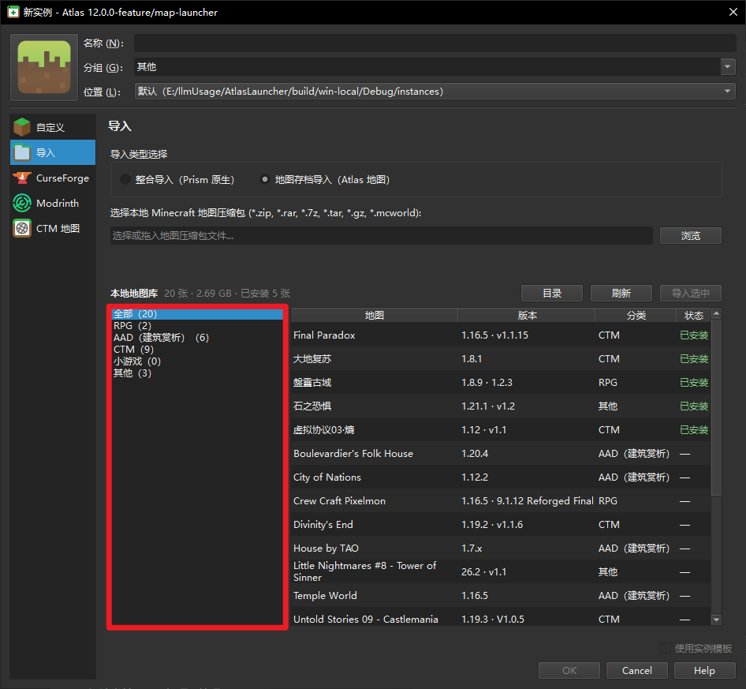
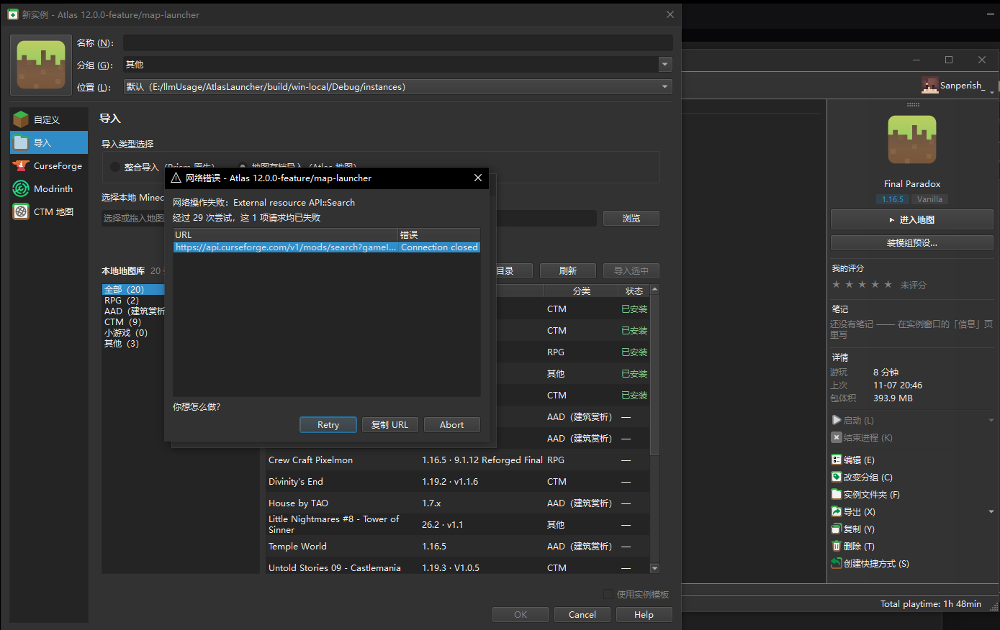

# 05 · 进度与遗留

> **唯一的状态事实来源。** 其它文档不写进度；如果别处与本文件冲突，以本文件为准。
> 最后更新：2026-11-10 11:00

---

## 1. 一句话状态

构建通过 · 测试 **66 passed / 0 failed / 2 skipped**（`MapArchiveScan_test` 17 + `ModPresets_test` 14 +
`DownloadSource_test` 12 + `RequestRetry_test` 23）· M0 完成 · M1–M5 代码全部落地。

真机已经过：**1.20+ 点卡片直接进图**（含 Fabric Loader 实例）、**连续两次「退出存档 → 游戏自动关闭」**、
**下载栈改造后的大文件下载**（`client.jar` 368 KB/s → 2998 KB/s，sha1 一致）、
**导入一个版本时进度窗口的速度/并行面板**（六行文件、总速度、`×N 段` 都显示正常）、
**残留 `.part` 导致的 416 死循环**（修掉后 `meta/index.json` 1 秒下完）、
**地图解压异步化与取消响应**、**启动期孤儿临时目录与 `.part` 碎片自动清理**、
**Agent 符号表按真实 jar 全量校正（60 张符号表逐槽位审计 100% 通过）**。
**本地地图库**（分类 / 已安装标识 / 拖拽归类）已落地并在真机上验证过，
存量 20 张图已按 `[版本]英文名 版本号 中文名` 整理入库（§2 M5）。

**真机反馈的 4 个问题已全部闭环解决**（分类栏收窄与列宽防截断、打开导入页轻量静默不弹网络错误框、纯英文短分类名与方案 B 动态自定义分类、重装地图支持可选备份与中文「是/否」对话框，见 **§8**）。

没有代码层面的阻塞项；唯一的现实阻碍仍是**网络**：Mojang 的资源域在部分线路被直接断连（不是超时），
BMCLAPI 的 302 节点多数被 TLS 重置（§6 8.1）。下载侧现在是**七层**，各自对着一种独立的失败形态，
抽掉任何一层都会退回"卡住"（设计见 [02](02-架构与路线图.md) §3.6.3）：

| 失败形态 | 应对 |
| --- | --- |
| 连接被掐断（下到一半 `Connection closed`） | `.part` **断点续传**，重试不从 0 开始（§3 #1） |
| 死连接（不回包也不断开） | **20 秒空闲看门狗**（§3 #2） |
| **有响应头、body 再也不来（或彻底静默）** | **20 秒空闲看门狗，覆盖整条传输**（响应头前后都算；每次收到数据重新起表）→ 分片则由各片从断点重连（[06](06-变更记录.md) §39） |
| 龟速（有数据但 20 KB/s） | **10 秒吞吐窗口，<15 KB/s 连续两次换连接**（§3 #2）；**分片模式按片判**，慢片 abort 后从断点续 |
| 这个源整体不行 | **镜像 ↔ 官方双向各回落一次**，互斥不绕圈（§3 #3） |
| 只剩一个大文件 | **16 段并发 + 连接池 48 条**（§3 #0、§6 8.2） |
| 分片某段卡死 | 分片断点续；连续 3 次零进展后先**段数减半重试一次**，再退回单连接 |

曾经卡了好几轮的「视角锁死 / 狂转」最终确认是**远程控制软件**（ToDesk / 向日葵）
造成的，与本项目无关：断开远控后视角正常（[06](06-变更记录.md) §17 #64）。
真机验证新增：**≤1.19.4 的 Agent 链路（1.8.9、1.12 Forge、1.16.5 真机自动进图、实验性设置弹窗跳过、落盘检测安全退出已全线通过）**，攻克 Forge 1.12 `TerminalTransformer` 与 `FMLSecurityManager` 退出拦截并接入 `MapQuitWatcher` 双保险守护；启动组件校验实行**「本地离线优先（Offline First）」**，彻底杜绝每次启动重复下载境外 `index.json` 导致的卡死；仅剩跨盘资源迁移与极端弱网换节点未特殊压测。

| 项 | 值 |
| --- | --- |
| 分支 | `feature/map-launcher`（基于 `develop@6e6f81779`） |
| 产物 | `build/win-local/Debug/atlas.exe`（32 MB）、`LauncherTests.exe`（29 MB） |
| 新代码 | `launcher/maps/` **37 个 .cpp + 41 个 .h，18,433 行**；另有 `launcher/ResourcePaths`、`launcher/net/DownloadSource`（换源）；`launcher/net/{Request,FileSink}` 有较大改动（续传 / 看门狗 / 重试 / 连接池 / 分片） |
| 既有文件改动 | 相对 `develop` 共 **279 个文件**、+32,700 / −4,030（含删除上游 CI 与 nix 文件）；对既有源码只做加法（见 §4.3） |
| 数据目录 | 便携模式：`build/win-local/Debug/`（`portable.txt`）；资源库已从 `asset/AtlasResources-2026-11-06.zip` 完整恢复（13,982 文件 / 4.06 GB，`assets` + `libraries` + `java` + `meta` + `metacache`，清单逐条比对通过），`metacache` 与恢复前的条目做过并集（保留 11-06 之后新下的 69 条） |
| 大厅本地库 | 1000 张地图 / 2243 条详情 / 1000 条评论（约 2.5 MB） |

---

## 2. 里程碑

| 里程碑 | 内容 | 状态 |
| --- | --- | --- |
| **M0** | 归档嗅探 + 三级版本判定 + `dataversion.json` | ✅ **完成**：23 个 AIO 夹具逐项一致（版本 / 置信度 / 世界数 / 材质包数） |
| **M1** | 导入建实例 + 主界面融入 + ≥1.20 直连 | 🟡 **进图已在真机通过**（1.21.1 quickPlay：点卡片 → 出生点）；带数据包的图原来会先弹「实验性设置」确认，现已加 `introskip` 跳过（**2026-11-03 21:49 真机确认**，见 §5 #18） |
| **M2** | Agent 直连（≤1.19.4）+ 安全退出判定 | ✅ **完成（2026-11-08 真机确认）**：1.8.9、1.12（Forge `[SP03] Entropy`）、1.16.5 均通过实机验证，跳过主菜单秒进地图，Esc 保存并退出后安全秒退回桌面（攻克 Forge 1.12 `TerminalTransformer` 与 `FMLSecurityManager` 退出拦截），`MapQuitWatcher` 外层监听 `EXIT_SAFE` 双保险守护。符号表已从 12 张扩到 **59 张（1.6.1–1.19.4 全量，逐张对着真实 client jar 校验）**，矩阵见 [`agent-matrix.md`](agent-matrix.md) |
| **M3** | 大厅 + 打磨 | 🟡 搜索/排序/系列·难度·长度·年份筛选/详情 11 项/评论分页/封面真图 + 磁盘缓存/评论卡片/设置页（地图·资源）/**1.20+ 退出即关（✅ 真机连开两次均通过）**；三档瓦片尺寸与快捷键未做 |
| **M4** | 一键装模组预设 | 🟡 代码完成：内置 3 套预设（每条带说明）+ 按实例版本/加载器现查 **Modrinth / CurseForge** + 逐条勾选安装 + **自动装 required 依赖**（取消主条目会连带取消）+ **已安装项标注并默认排除** + 双平台搜索添加 + 自建预设；**差真机复看** |
| **M5** | 本地地图库（分类 / 已安装 / 拖拽归类） | ✅ **完成（2026-11-09 / 11-10 落地并闭环真机反馈）**：`maps/` 20 个包按 `[版本]英文名 版本号 中文名` 整理入库；面板挂在「添加实例 → 导入 → 地图存档导入」下方；拖拽归类、已安装标识、左栏宽度收紧（132px）、CF 搜索静默防阻塞、方案 B 动态自定义分类（增删改 + Other 兜底）以及重装地图可选备份与中文「是/否」对话框全通 |

---

## 3. 下一步（按优先级）

0. ~~单文件分段下载~~ ✅ **已做（2026-11-04 / 11-05 修完三个 bug）**：设置 → 启动器 → 任务 →
   「大文件分片下载」（`DownloadChunks`，默认 16 段）。`client.jar` 实测 368 KB/s → 2998 KB/s、
   sha1 一致；分片失败从断点续，服务器不认 Range 或连续失败时先减半段数再退回单连接
   （[06](06-变更记录.md) §32、§33、§43）。
1. ~~断点续传（Range）~~ ✅ **已做（2026-11-05）**：顺序下载写 `<目标>.part`、重试带
   `Range: bytes=N-`、续写前把已有字节补喂校验器；服务器无视 Range 就 `restartFromZero()`；
   416 视为`.part` 已满并丢弃重来。真实网络验证：预置 100 KB 种子 → 206 续完 → sha1 一致
   （[06](06-变更记录.md) §36）。**剩真机**：跨进程续传的 GUI 证据还没抓到（那两次网络本身在 stall）。
2. ~~死连接 / 龟速~~ ✅ **已做（2026-11-05 / 11-06）**：**20 秒空闲看门狗覆盖整条传输**
   （响应头前后都算，每收到一次数据重新起表）+ 10 秒吞吐窗口（<15 KB/s 连续两次换连接，
   全局最多 3 次；**分片按片判**，慢片从断点重连）、官方↔镜像双向回落
   （[06](06-变更记录.md) §37、§38、§39、§41）。
   **剩**：15 KB/s / 20 秒两个阈值都是拿本线路实测定的，真慢的网络会多花一分钟才放行。
3. **模组预设的真机验收**：地图实例 → 右侧「装模组预设…」→ 选 Fabric 性能 → 确认每行都解析出
   对应 1.21.1 的版本 → 安装 → 进游戏看模组列表。重点是**未装加载器时的引导**（应弹一句后
   打开安装向导）、**解析不到时的标红**、**已安装项被标注并默认不勾**。
4. ~~镜像下载的重试~~ ✅ **已做（2026-11-04）**：连接失败/网络停滞时回到本轮起点重试，最多 3 次；
   官方源同样生效；镜像 3 次都失败则**回落官方源一次**。`OperationCanceledError` 不再被当成
   用户取消（那是传输超时）—— 见 [06](06-变更记录.md) §29 与 §30。
5. ~~≤1.19.4 的 Agent 真机验收~~ ✅ **已做（2026-11-08）**：1.8.9、1.12（Forge）、1.16.5 实机全通，进图与退出落盘关闭均正常，`agent.log` 见 `EXIT_SAFE`，攻克 Forge 1.12 安全管理器与字节码重写停机拦截。
6. **资源迁移真机验证**：设置 → 资源 → 选另一个盘 → 应用资源库 → 重启 → 进图；
   重点看跨盘复制是否完整、旧目录是否删干净（同盘是 `rename`，几乎瞬间）。
7. **RAR5 大包**：分卷 / 加密头（夹具里只有小 RAR）。
8. ~~补符号表~~ ✅ **已做（2026-11-07 / 11-08 全量校正）**：从 12 张主流版本扩到 **60 张**（Agent 轨道 59 张，覆盖
   1.6.1–1.19.4 的每一个正式版；另有 1.21.1 一张留作 quickPlay 轨道对照）。生成方式：1.14.4+ 用 Mojang 官方
   `client_mappings` → 21 张；更早的用字节码指纹 → 39 张。**每一张的每个槽位都对着真实 client jar 复核**
   （类存在、方法名 + 描述符存在、static 标记一致），矩阵与缺口原因见 [`agent-matrix.md`](agent-matrix.md)。
   同时查出并修掉一张**假表**：原 `1.7.10.json` 里 `blr.b()V` / `bib.z()` 在 1.7.10 的 jar 里根本不存在
   （是拿 1.12.2 的名字拼的），现按真实 jar 重新生成。
9. ~~解压异步化与支持取消~~ ✅ **已做（2026-11-07）**：`MapImportTask` 线程池异步化 + 允许取消与回滚清理，重装任务 `MapReinstallTask` 接入异步进度对话框。
10. ~~启动期磁盘碎片清理~~ ✅ **已做（2026-11-07）**：`MapDiskCleanup::cleanAsync` 启动期异步清理 `instances/.tmp/*` 孤儿目录、`.part.parallel`、`.part-*` 及过期 `.part`。
11. **导入流程的加载器版本选择器**（现在手填，或导入后到实例「版本」页装）。
12. **「换源」建议**：启动失败时除了 Retry，直接给一个「改用 XX 源重试」按钮（见 §5 #20）。
13. ~~启动组件校验「本地离线优先」~~ ✅ **已做（2026-11-08）**：`MinecraftLoadAndCheck` 优先 `Net::Mode::Offline`，消除已有实例每次启动拉取境外 `index.json` / `index_v2.json` 造成的 `0.00 KiB` 卡死。
14. ~~进度对话框 UI 细节打磨~~ ✅ **已做（2026-11-08）**：并行下载面板自适应消除空白；重置多阶段任务时清理取消按钮与 QSizeGrip 堆叠。
15. ~~Forge 与 OptiFine 兼容与安装逻辑修复~~ ✅ **已做（2026-11-08）**：修复 `PackProfile` 对 OptiFine 补丁层级的判定与报错。

> 已完成（2026-11-03 21:49 真机确认）：introskip 跳过「实验性设置」确认页 —— 客户端日志
> `21:49:56 已跳过确认页` → `21:49:59 加入了游戏`。见 §5 #18 与 [06](06-变更记录.md) §18。

> 已经排除的旧条目（不要再当待办）：**视角锁死 / 狂转** —— 成因是远程控制软件，断开远控即正常，
> 与启动器无关；排查过程见 [06](06-变更记录.md) §17。

---

## 4. 代码清单

### 4.1 新增（`launcher/maps/`）

| 文件 | 职责 |
| --- | --- |
| `MapTypes.h` | Confidence / LevelDatFacts（含 `requiredMods`）/ MapLayoutFacts / VersionGuess |
| `MapTextUtils.{h,cpp}` | 剥 § 格式化码、GBK 回退解码、版本号抠取、游玩时长格式化 |
| `DataVersionTable.{h,cpp}` | 483 个版本 / 481 条 DataVersion 双向索引、Java 大版本、quickPlay 判定 |
| `LevelDatReader.{h,cpp}` | level.dat（GZip + NBT）→ 版本字段 / BorderSize / ServerBrands / `FML LoadingModList` |
| `MapVersionDetector.{h,cpp}` | 三级判定 + 冲突裁决 + 26.x 拒绝猜测 |
| `MapArchiveScanner.{h,cpp}` | 免解压嗅探：世界根、结构特征、材质包 / 模组 / 说明文件 |
| `MapMeta.{h,cpp}` | `map.json` 唯一读写点：证据链、世界列表、统计、模组清单 |
| `MapNotes.{h,cpp}` | `notes.json`：中文名 / 评分（半星）/ 笔记。与 `map.json` 分文件 |
| `MapImportTask.{h,cpp}` | 建实例 → 解世界（线程池异步化 + 支持中途取消）→ 落材质包 / 模组 → 合并 `options.txt` → 写 `map.json`；`MapReinstallTask` 异步重装（支持勾选备份至 `saves/.mcml-backup/<时间戳>/` 或直接重装，且提供中文「是/否」对话框） |
| `MapDiskCleanup.{h,cpp}` | 启动期与常规磁盘碎片清理：清理 `.part.parallel`、`.part-*`、过期 `.part` 及 `instances/.tmp/*` 孤儿目录 |
| `MapRepository.{h,cpp}` | 实例列表 → 地图列表（判据：有 `map.json`）、地图库归档与路径回退 |
| `MapLibrary.{h,cpp}` | 本地地图库模型：`map-library.json` 读写（文件名做键、原子写）、默认纯英文分类（RPG / AAD / CTM / MiniGame / Other）与方案 B 自定义分类增删改、目录扫描、按实例引用算「已安装」、导入后补元数据 |
| `MapLibraryPanel.{h,cpp}` | 库面板：分类栏（固定宽度 132px 防截断，带 `+`/`-` 按钮与右键分类管理）+ 列表、拖行到分类即归类、双击/按钮走现有导入链路、打开库目录/刷新 |
| `MapLaunchPrep.{h,cpp}` | 只认 trait 选轨道、可指定世界、退出后按 `agent.log` 回写统计；`prepareForLaunch()` 是所有启动入口的唯一准备点 |
| `AgentBootstrap.{h,cpp}` | 符号表 → `k=v,k=v`、JvmArgs 注入、事件解析与日志监听 |
| `MapHallLink.{h,cpp}` | 实例 ↔ CTM 地图关联（`hall-link.json`），删文件即解除 |
| `HallCache.{h,cpp}` | 大厅本地库：4 个接口的原始行 → `hall-cache.json`（原子写）；`detailsCoverList` 判完整性 |
| `HallAPI.{h,cpp}` + `HallTypes.h` | 搜索 / 详情 / 筛选 / 评论分页 / 用户名补全 / 失败分类 / 整库同步 |
| `HallProxy.{h,cpp}` | 出口解析：环境变量 → 本地端口扫描 → 系统代理 → 直连；`shouldBypassProxy` |
| `BrowserFetch.{h,cpp}` | 浏览器通道：本地页面 + XHR + 退避重试 + base64 回传 |
| `MapCoverLoader.{h,cpp}` | 封面：直连失败切无头浏览器批量取图 + 内存 LRU + 磁盘缓存 + 占位封面 |
| `MapImportDialog.{h,cpp}` | 名称 / 世界 / 版本 / 加载器 + 证据 + 置信度红条 + 缺模组提示 |
| `MapHallPage.{h,cpp}` | 「添加实例 → CTM 地图」页：搜索 / 排序 / 四个筛选 / 封面列表 / 详情三页签 |
| `HallDialog.{h,cpp}` | 独立大厅对话框（菜单入口）：搜索 + 表格 + 详情 + 评论 |
| `MapInstanceBar.{h,cpp}` | 右侧操作栏地图卡片：中文名 / 徽章（居中）/ 评分 / 笔记 / 详情（游玩·上次·包体积，关联 CTM 后加作者·系列）/ 世界下拉 / 主按钮 |
| `MapInstancePage.{h,cpp}` | 实例「信息」页：简介（封面 + 基本信息）/ 评论 / 我的（三张卡片） |
| `MapReviewCard.{h,cpp}` | 评论卡片（大厅与信息页共用） |
| `MapInfoCard.{h,cpp}` | 信息卡片工厂（`makeCard` / `makeKeyLabel` / `clearLayout`），大厅详情与信息页共用 |
| `MapGalleryPage/Window.{h,cpp}` | 画廊（次要入口，仅独立窗口） |
| `ModPresets.{h,cpp}` | 模组预设：`mod-presets.json` 读写 + 内置三套 + `ModPresetResolveTask`（Modrinth / CurseForge 逐条查版本，release 优先，递归 required 依赖，批量补依赖名）+ `ModSearchTask` |
| `ModPresetDialog.{h,cpp}` | 预设选择/安装（勾选、说明列、依赖行、自己挑…）+ 预设编辑（一行一个模组，支持 `cf:<id>`） |
| `ModSearchDialog.{h,cpp}` | 双平台搜索添加（Modrinth / CurseForge，多选） |
| `MapSettingsWidget.{h,cpp}` | 地图设置内容体：自动进图 / 退出即关 / 进图延迟（实例可覆盖）+ 地图库 / 大厅 / 控制台页签（仅全局） |
| `MapPage.h` | 全局设置的「地图」页（排在「常规」右边） |
| `MapQuitWatcher.{h,cpp}` | 1.20+ 轨道：盯游戏日志（离开存档 → 全部落盘）后关游戏窗口；300ms 核对一次「连的还是不是当前 `LaunchTask`」 |
| `MapWindowFocus.{h,cpp}` | 启动后把前台交给游戏窗口 —— 针对 quickPlay 在「窗口无焦点」时抓不住鼠标的已知缺陷（MCL-24083）的兜底；与本次的视角问题无关（那是远控软件） |
| `net/DownloadMonitor.{h,cpp}` | 旁路观测：正在跑的 NetJob 聚合成快照（整体/单文件速度、活跃文件），供进度面板轮询 |
| `ui/widgets/DownloadPanel.{h,cpp}` | 下载面板：`下载中 · 已收 X · Y/s · 文件 n/m` + 每行「文件名 / 进度 / 大小 / 速度 / ×N 段」 |
| `ResourceStore.{h,cpp}` | 资源库迁移：assets / libraries / java 搬到指定目录（同盘改名，跨盘复制后删源） |
| `MapResourcePage.{h,cpp}` | 全局设置的「资源」页：选择目录 / 检测本机已有资源 / 一键迁移 |
| `OptiFineDialog.{h,cpp}` | 安装 OptiFine（版本页入口），BMCLAPI → 官网双源 |
| `StarRatingWidget.{h,cpp}` | 星级控件（只读给卡片，可编辑给「我的」） |
| `MapTheme.h` | 主题色与卡片样式（不写死颜色） |

### 4.2 新增（资源与测试）

| 路径 | 内容 |
| --- | --- |
| `launcher/resources/maps/` | `dataversion.json`（483 版本）+ `maps.qrc` |
| `launcher/resources/agents/` | `quickboot.jar`（ASM 已 shade）+ `introskip.jar` + **60 张符号表** + `agents.qrc`（由审计脚本按目录重写） |
| `launcher/ResourcePaths.{h,cpp}` | assets / libraries / java 的绝对路径解析（共享目录优先，见 [02](02-架构与路线图.md) §2.3） |
| `tests/MapArchiveScan_test.cpp` | 16 项常规测试（含磁盘清理、旁证来源名 UTF-8、随包符号表逐张可拼参数） + 2 项联网用例（默认 skip） |
| `tests/ModPresets_test.cpp` | 14 项：内置预设合法性、加载器匹配、双平台搜索响应解析 |
| `tests/DownloadSource_test.cpp` | 12 项：镜像映射表逐条、不该映射的域、幂等、显式选源 |
| `tests/RequestRetry_test.cpp` | 21 项：错误分类表、`FileSink` 重入/abort 后的写入语义、校验器重置、假网络下的「302 → 节点断连 → 回到入口」全链路、重试预算、官方源重试、传输超时重试、停滞错误可读、镜像→官方回落单向、切分连续性、乱序写入、校验失败不落盘、**断点续传 / 服务器无视 Range / 校验器补喂 / 分片预分配隔离 / 官方→镜像回落** |
| `launcher/ui/dialogs/ImportChoiceDialog.{h,cpp}` | 拖拽压缩包时的导入模式抉择对话框（整合 vs 地图存档，带智能特征探测）（§45） |
| `launcher/resources/agents/introskip.jar` | 1.20+ 跳过「实验性设置」确认页的 Java Agent（ASM 已重定位到 `atlas/introskip/shaded/asm`） |
| `launcher/resources/agents/introskip.json` | 13 个版本（1.20–1.21.5）的 `WorldOpenFlows.askForBackup` 混淆签名 + `loadLevel` 槽位 |
| `tools/introskip-agent/` | 上面两个文件的源码与构建脚本（`build.sh` / `gen_table.py` / `relocate/`） |
| `tools/agent_symbol_audit.py` | 符号表审计与生成：`audit` 模式逐槽位对着真实 client jar 复核；`generate` 模式为缺表版本生成（1.14.4+ 拉官方 `client_mappings`，更早走字节码指纹），落盘前独立复核；`--sync-qrc` 按目录重写 `agents.qrc`；`--report` 输出覆盖矩阵 |
| `tools/map_library_scan.py` | **只读**盘点一个目录里的地图包：7z 列目录 → 只抽 `level.dat` → NBT 读版本/存档名，输出体积、sha1、世界数与重复项（整理前的体检） |
| `tools/map_library_migrate.py` | 存量整理：按 `[版本]英文名 版本号 中文名` 改名（幂等）、写 `map-library.json`、修正实例 `map.json` 的库引用；`--dry-run` 先看计划，改名记录落 `build/map-library-rename.json` |
| `docs/atlas/agent-matrix.md` | 由上面脚本生成的覆盖矩阵：哪 60 个版本有表、每张表什么来源、哪 20 个版本不能自动进图以及确切原因 |

### 4.3 改动的既有文件

| 文件 | 改了什么 |
| --- | --- |
| `launcher/CMakeLists.txt` | `MAPS_SOURCES` + 两个 qrc + `MapWindowFocus` |
| `launcher/Application.cpp` | 地图设置项 + 资源库设置项 + `launch()` 里的统一准备点（`MapLaunchPrep` / `MapQuitWatcher` / `MapWindowFocus`） |
| `launcher/minecraft/MinecraftInstance.cpp` | `processMinecraftArgs` 读 `JoinWorldOnLaunch`；启动脚本已写 `worldName` 时不再重复拼 `--quickPlaySingleplayer` |
| `launcher/tasks/Task.cpp` | 三处 `ASSERT_NEVER(!isRunning())` 改普通守卫（Debug 下 `qFatal` 会把启动失败升级成整个启动器退出） |
| `launcher/java/JavaChecker.cpp` | 被 15s 超时杀掉但 stdout 已有 `java.version` 时按有效结果继续，不再误判「起不了 java」 |
| `launcher/settings/INISettingsObject.{h,cpp}`、`SettingsObject.h` | `suspendSave` 从 `bool` 改计数器（`SettingsObject::Lock` 是 RAII，嵌套加锁合法） |
| `launcher/ui/MainWindow.{h,cpp}` | 操作栏接线、菜单、拖放弹 `ImportChoiceDialog` 分流（§45）、后台更新大厅 |
| `launcher/ui/dialogs/NewInstanceDialog.{h,cpp}` | 支持 `initialPage`；精简来源页 |
| `launcher/ui/pages/modplatform/ImportPage.{h,cpp,ui}` | 整合与地图存档双轨模式切换、解耦任务派发、智能提示与一键模式切换、直接拖拽支持（§45） |
| `launcher/InstancePageProvider.h` | 页签重排（设置置顶）+ 信息页 |
| `launcher/ui/InstanceWindow.cpp` | 默认停在「设置」 |
| `launcher/archive/ArchiveReader.{h,cpp}`、`ArchiveWriter.cpp` | `File::size()`；修 2 处上游编译错误 |
| `launcher/tasks/{Sequential,Concurrent}Task.cpp` | 修 Debug 断言崩溃 |
| `launcher/ui/pages/instance/WorldListPage.cpp` | 地图实例的世界列表只读 |
| `launcher/launch/LaunchTask.{h,cpp}` | 新增 `gameLogLine` 信号（逐行日志，给退出看门狗用） |
| `launcher/minecraft/AssetsUtils.cpp`、`update/AssetUpdateTask.cpp` | 资产/索引路径改走 `ResourcePaths` |
| `launcher/net/Request.{h,cpp}` | 镜像换节点重试（回到入口、最多 3 次、只认连接错误与 GET）+ `Option::NoMirrorRetry`；把 `APPLICATION` 改成 `APPLICATION_DYN`；分片断点续传与减半段数重试（§43） |
| `launcher/net/FileSink.{h,cpp}` | `init()` 重入时先 `cancelWriting()` 掉上一轮；目标文件 `.part` 归属表防争抢（§41）；校验失败与改名失败时释放占用（§44） |
| `launcher/net/DownloadMonitor.{h,cpp}` | 旁路聚合下载快照；按活跃项正向增量累加计算瞬时速率，消除单文件完成移出列表导致的跳 0 缺陷（§44） |
| `launcher/ResourcePaths.{h,cpp}`、`maps/HallCache.cpp`、`maps/ResourceStore.cpp`、`maps/ModPresets.cpp` | 数据/路径模块改走 `APPLICATION_DYN`，保障无 GUI 单测与后台调用的健壮性（§44） |
| `launcher/maps/MapArchiveScanner.cpp` | 归档路径多重前缀规范化（剥离 `./`、`/`、`\`），避免异常压缩包结构引发解压路径偏移（§44） |
| `launcher/net/NetJob.{h,cpp}` | 构造/析构登记到 `DownloadMonitor`；新增 `activeDownloads()` / `doneCount()` 供下载面板取快照 |
| `launcher/ui/dialogs/ProgressDialog.{h,cpp}` | 内嵌下载面板、总进度条改「n / m 个文件（%）」、右上角显示总速度、下载时隐藏步骤条 |
| `launcher/ui/pages/global/LauncherPage.ui` | 分片数的说明文案更新（默认 16 段、可调到 32） |
| `launcher/ui/dialogs/DownloadSourceTestDialog.cpp` | 连通性测试带 `NoMirrorRetry`，避免"自带 5 次"被叠成 20 次 |
| `launcher/ui/pages/global/MinecraftPage.h` | 页名 `Minecraft` → **游戏** |

---

## 5. 还剩什么（诚实清单）

| # | 事项 | 说明 |
| --- | --- | --- |
| 1 | RAR5 大包 | 分卷 / 加密头未测 |
| 1.1 | ~~地图库真机反馈问题~~ | ✅ **已解决（2026-11-09 / 11-10）**：① 分类栏固定 132px，分类与状态列自适应不截断；② CF 搜索关闭阻塞弹窗并设单次尝试；③ 分类名纯英文短名，方案 B 实现动态自定义增删改与 Other 转移兜底；④ 重装地图支持可选备份与中文「是/否」对话框（见 **§8**） |
| 1.2 | **`Smaller CTM` 实例缺备份压缩包** | `map.json` 指向 `maps/Smaller CTM.rar`（库里没有）与 `D:/Games/.../saves/Smaller CTM.rar`（换机器前的旧路径），两处都不存在；重装会缺源，需要玩家把包放回库目录 |
| 1.3 | 库里的中文名有 10 张是空的 | 命名整理只采用有证据的中文名（文件名 / notes.json）；`Divinity's End` 这类保持英文，可在 `map-library.json` 里补 |
| 2 | 导入流程的加载器版本选择器 | 目前手填 |
| 3 | ~~模组套件~~ | ✅ 已做（M4）：自带 3 套预设 + 双平台搜索 + 依赖自动安装；AIO 那 4 套没有逐条搬，玩家可自建 |
| 4 | 符号表覆盖 | **59 个版本（1.6.1–1.19.4 全量）**，每张都对着真实 jar 校验过；仍有 20 个版本没有表：1.0–1.2.5（无集成服务端）、1.3–1.5.2（主菜单构建方法有多个同签名候选）、1.14–1.14.3（早于官方 `client_mappings`，结构上 3 个 setScreen / 14 个 `(Z)V` 候选）。缺表时降级「停在主菜单 + 提示」，不猜。原因逐条见 [`agent-matrix.md`](agent-matrix.md) |
| 5 | ~~地图解压仍是同步的~~ | ✅ **已做（2026-11-07）**：`MapImportTask` / `MapReinstallTask` 已搬到 `QtConcurrent` 线程池，支持中途取消与回滚（见 §3 #9）；这条描述停留在 11-05 的状态，已过期 |
| 6 | `map.json` 的 `archive.sha1` 恒空 | 导入时不额外读整包（大包多花 10 秒不值） |
| 7 | ~~Agent 参数落在 `JvmArgs` 上~~ | ✅ 已改：参数放实例的运行时属性 `mapsJavaAgents`，由 `MinecraftInstance::extraArguments()` 追加，不落盘、不碰用户的 `JvmArgs`。原写法因 `OverrideJavaArgs` 语义**从未生效**（2026-11-03 真机查实） |
| 8 | UI 文案的中文写在 `tr()` 源串里 | 切英文仍显示中文；国际化要先改源串再补 `.ts` |
| 9 | `ctmrepository.com` 的 50 张封面取不到 | Cloudflare 不认无头浏览器；其余 874 张 supabase 正常 |
| 10 | 首次打开大厅要等约 12 秒 | 一个无头进程一批取 8 张，20 行要 3 批；之后磁盘命中 |
| 11 | 封面缓存无上限、无清理入口 | 单张约 20 KB；要加就在「设置 → 地图」加「清空封面缓存」 |
| 12 | 筛选是单选 | 站上难度/长度可多选；`HallQuery` 已支持列表，改 UI 即可 |
| 13 | 没有版本筛选 | 需要动 `HallQuery` 与 PostgREST 查询，超出"小改"范围 |
| 14 | 三档瓦片尺寸、快捷键 | M3 里明确未做 |
| 15 | **资源迁移没在真机验证过** | 同盘 `rename` 很快，跨盘是逐个复制 + 删源；迁移前最好确认没有游戏在跑 |
| 16 | 资源位置改完**要重启启动器** | assets/libraries 的绝对路径在启动时进了 meta cache；页面上已写明 |
| 17 | 1.20+ 的退出判定依赖两句英文日志 | 服务端日志不受客户端语言影响；但换版本/装改日志的模组时要复核 |
| 18 | **「实验性设置」确认页** | ✅ **真机确认**（2026-11-03 21:49）：`introskip` 把 `WorldOpenFlows.askForBackup` 改成直接执行 `loadLevel`，客户端日志 `已跳过确认页` 后 3 秒进图。世界数据、数据包、`level.dat` 一律不动。设置项 `MapSkipExperimentalPrompt`（默认开，可被实例覆盖）。日志：`<数据目录>/agents/introskip-<hash>.log`（**纯 ASCII 路径**，实例目录名含非 GBK 字符时也能写）。版本表覆盖 1.20–1.21.5，新版本需重跑 `gen_table.py` |
| 19 | ~~下载源只有官方~~ | ✅ **已做**（2026-11-04）：设置 → API 顶部「下载源」可选 BMCLAPI 镜像，覆盖资源 / 库 / 版本 json / 运行时清单，镜像请求直连不走代理；默认仍是官方，官方路径一个字节没改。镜像模式下「资源服务器」由镜像接管，旁边有「测试连通性…」。见 [06](06-变更记录.md) §26、§27 |
| 20 | 启动失败时的提示 | 单个请求的失败原因已改成能看懂的话（「网络停滞：长时间收不到数据（已重试 3 次）」而不是 `Operation canceled`），但**任务级弹窗**仍是「n 项请求失败 + 一串 URL + Retry」。剩：直接给「改用 XX 源重试」按钮（[06](06-变更记录.md) §30） |

---

## 6. 未验证 / 已知未知

1. **Prism 的 meta 是否给所有 1.20+ 版本都带 `feature:is_quick_play_singleplayer` trait** ——
   代码按 trait 判断（不写死版本号），但没实机验证 1.20.2 / 1.21.x 全量。
   （冷启动 traits 为空时现在有版本表兜底，见 [06](06-变更记录.md) §50.2。）
2. **libarchive 对 RAR5 / 加密头 / 分卷的真实边界** —— 夹具里的 RAR 能扫，大包没测。
3. **Agent 与 Forge 的 FML ClassLoader 冲突** —— 已照 AIO 的解法实现（参数落系统属性 + 自写日志），
   但**没有 1.12.2 + Forge 的资产可测**。
   另：**59 张表里只有 1.8.9 / 1.12 / 1.16.5 上过真机**，其余（含重新生成的 1.7.10 与
   1.6–1.13 的指纹表）只到「每个槽位都能在真实 jar 里查到」这一步，没有启动过游戏。
4. **AIO 的 8 张真实地图**在 `E:/llmUsage/Minecraft-AIO/launcher/env/profiles/*.json`；
   M0 回归用的是 `launcher/fixtures/` 的 23 个夹具（更全且带期望值）。
5. **封面仍有一类取不到**：`ctmrepository.com` 的 50 张（Cloudflare），已确认不是代码问题。
6. **便携模式下 `build` 目录即数据目录**：clean 会连玩家数据一起删。
   6.1 ~~被中断的导入会留下 `instances/.tmp/<6位key>`~~：✅ **已解决（2026-11-07）**：已由 `MapDiskCleanup::cleanAsync` 在启动期异步清理孤儿临时目录（见 §3 #10）。
   6.2 **大包解压在 Debug 版下很慢**（162 MB / 约 700 个 region 要 3–5 分钟）：Release 会快很多，别把 Debug 的耗时当产品性能。
7. **资源迁移的跨盘行为**（复制完整性、旧目录删除失败的回退提示）只在代码层验证过，没在真机搬过几 GB。
8. **网络环境差异**：`resources.download.minecraft.net` / `maven.fabricmc.net` 在部分线路（校园网、
   公司代理、部分家宽）会被 TLS 层直接重置；启动器此前单源直连、失败即整体失败（现已有下载源开关，
   见 §5 #19）。2026-11-04 实测：
   同一台机器上官方域 `Connection closed`，BMCLAPI 直连 200。**结论是"路径对、网络不通"，不是代码错**。
   现在有「Download Source」开关可以一键换到 BMCLAPI（§5 #19）。
   8.1 **镜像本身也不是 100% 可用**：BMCLAPI 会 302 到随机的 OpenBMCLAPI 节点，实测单次成功率
   仅 **30–50%**。2026-11-04 又查清一层：坏的不是入口，是 302 指出去的节点 —— 这条线路对
   `*.sakura.sld.tw` / `*.sakura.exp.dog` 做 TLS 重置（`curl: (35) Recv failure: Connection was reset`），
   偶尔抽到 `cmcc.mirrors.ustc.edu.cn` 就有 1.3 MB/s。所以"镜像全红、官方绿"是**节点抽签**，
   不是映射表或配置错（[06](06-变更记录.md) §30）。
   现在两侧都有重试：连通性测试每条 5 次；**真实下载每条最多 3 次，镜像↔官方双向各回落一次**
   （互斥，不绕圈）。仍失败时是显式弹窗 + 重试按钮，已下好的文件不会重下。
   8.2 **带宽是按连接分配的**：实测同一文件 1 条 60 KB/s、8 条 487 KB/s、32 条 1.19 MB/s。
   而 Qt 一个 QNAM 每主机最多 6 条连接，所以并发数调再高也没用 —— 现在用 4 个 QNAM 的池
   （24 条 → 2026-11-06 起 8 个 QNAM / 48 条），实测同一批 12 个文件 209 → 467 KB/s（[06](06-变更记录.md) §31、§41）。
   8.3 **官方 CDN 的速度本身在摆**：`libraries.minecraft.net` 同一时段可以从 30 KB/s 变到 1.2 MB/s，
   6 并发合计能到 1.86 MB/s。看到"只有 60 KB/s"先别怀疑启动器，量一下再判断。
   8.4 **"卡住"有三种完全不同的形态**，日志里长得不像但用户看到的都一样：① 连接被掐（有
   `Connection closed`，靠续传）；② 死连接（一行日志都没有，靠 20 秒空闲看门狗）；③ 龟速
   （20 KB/s 在爬，靠 10 秒吞吐窗口）。排查时先看 `Resuming` / `No response in` / `crawling`
   三个关键字落在哪一个（[06](06-变更记录.md) §36–§38）。
9. **复用外来资源库时库文件会被重下**：`libraries/` 的判定完全依赖 `metacache`（条目缺失＝未下载），
   所以从官方启动器或另一台机器拿来的 `libraries/` 会被整份重下。想省掉这一次，需要加一个"认领"
   路径：`Library::getDownloads()` 在条目缺失、本地文件存在、且 sha1 对得上时，给 `metacache`
   补一条记录（顺便算 md5）并跳过下载。目前没做，见 [03](03-环境与构建.md) §6.2。
10. ~~`.part` 残留没有自动清理~~：✅ **已解决（2026-11-07）**：已由 `MapDiskCleanup::cleanAsync` 在启动期自动扫描并清理超过有效期的 `.part`、`.part.parallel` 与 `.part-*` 分片文件（见 §3 #10 与 [06](06-变更记录.md) §36.4）。
11. **分片退到单连接后仍然很慢**：某些主机（piston-data 的 client.jar、libraries 的 fastutil）
   会在并发多时随机关连接。现在失败会**先减半段数重试一次**（16 → 8，或 12 → 6），仍不行才退回
   单连接（~10–25 KB/s）。已经实现在本次运行内不再递归降级；但它不会记住"这个 host 不适合拆段"，
   下次还会先试满段数。见 [06](06-变更记录.md) §35.3、§43。
12. **分片下载缺自动化覆盖**：`RequestRetry_test` 覆盖的是切分纯函数与 `FileSink` 的写入/校验，
   分片重试与降级只有真实网络探针跑过（每次验证后已删）。要给这块补单测，得把 `startChunk`
   里的 `QNAM->get()` 抽成可覆写的钩子。
13. **1.20+ 的退出看门狗**只在 1.21.1 上真机验证过（连开两次都正常关）；日志标记本身只按 1.21.1
   的实际措辞匹配，其他版本若改了 `Stopping singleplayer server as player logged out` /
   `All dimensions are saved`，会退化成「10 秒后关」（仍能关，只是不看落盘标记）。
14. **龟速阈值（15 KB/s）写死**：手机热点、限速网络这类"整条网就慢"的场景会被砍 3 次
   （每次 20 秒）后才放行 —— 不至于卡死，但会多花一分钟。做成设置项（或按已测速度自适应）
   更合适，见 [06](06-变更记录.md) §38.4。分片侧的阈值同样是这条线路上量出来的
   （每片 <150 KB/10 秒），每片最多因慢换 2 次连接，之后放行。
15. **空闲窗口（20 秒）也是经验值**：它只判"完全不动"，慢但活着不会被打断；
   需要排查时可以 `PRISM_NET_IDLE_TIMEOUT_MS` 临时改小（[06](06-变更记录.md) §39.5）。
16. **下载面板的"总量"只算已开始的文件**：未开始的还没有 Content-Length，所以进度会随着新文件
   加入而回退一点；这是有意的（不猜），见 [06](06-变更记录.md) §41.6。
17. **分片失败减半重试会丢掉已下的分片**：`.part.parallel` 是"预分配 + 空洞"，不能当续传前缀，
   所以 12 → 6 那次是从 0 重来（[06](06-变更记录.md) §43.3）。
18. **地图库的两条边界没实测**：① 有人在资源管理器里把库里的包改名/删掉之后，
   `map-library.json` 里会留一条孤儿条目（下次刷新会丢掉它，不会显示成别的图，但也没有提示）；
   ② 库目录设成网络盘/只读目录时，`QSaveFile` 写索引会失败，界面只弹一次警告。

---

## 7. 接手后的第一小时

1. **确认基线**：按 [03](03-环境与构建.md) 构建 + 跑测试，应为 `66 passed / 0 failed / 2 skipped`
   （`MapArchiveScan_test` 17 + `ModPresets_test` 14 + `DownloadSource_test` 12 + `RequestRetry_test` 23）；
   再跑一次 `python tools\agent_symbol_audit.py audit`，应为「有 jar 可查的表，全部与真实字节码对得上」（60 张全通）；
2. **走一遍主流程**：拖一张 1.20+ 地图进主窗口 → 弹出导入方式选择对话框（选择「作为地图导入」）→ 导入确认 → 选中实例（右侧应出现地图卡片）→
   原生「启动」→ **不应再弹**「实验性设置」确认页（`introskip` 默认开，见 §5 #18），直接落在出生点；
   退出存档 → 游戏应自己关。**如果鼠标/视角发疯，先断开远程控制软件**（历史坑，见 [06](06-变更记录.md) §17）；
3. **看日志**：地图相关只认这几个前缀 —— `Map launch plan:`（轨道与原因）、
   `Map quit watcher:`（挂载 / 接任务 / 关窗）、`Map window focus:`（前台交接）；
   下载相关看 `Splitting … into N ranges`（分段）、`Request failed … retrying from`（重试）、
   `Network stalled`（传输超时，不是用户取消）、`Server ignored the Range header`（退回单连接）、
   `Resuming … from byte N`（续传，正常）、`No response in 20 seconds`（连响应头都没有）、
   `Transfer idle for 20 seconds`（有响应头但 body 不动了）、
   `Download is crawling at`（单连接龟速）、`Range N is crawling at`（某一片龟速、准备从断点换连接）、
   `falling back to the mirror`（官方不行了换源）。
   **日志会滚动**：每次启动把 `Atlas-0.log` 变成 `Atlas-1.log`，所以文档里写「当时 `Atlas-0.log`」
   指的是那一次会话的最新日志，事后要按时间找；
4. **看大厅**：添加实例 → CTM 地图 → 等封面（首次约 12 秒）→ 搜索 / 筛选 / 看详情 / 评论；
5. 之后按 §3 的优先级推进。

> 设计上有疑问先看 [02](02-架构与路线图.md)；想改既有行为先看 [04](04-踩坑与决策.md) 的决策表。

---

## 8. 交接：真机反馈闭环与重装优化（2026-11-09 / 11-10 全部解决闭环）

> 针对用户上手真机后提出的各项反馈，已于 2026-11-09 与 11-10 全部完成修改并通过自动化单测。截图在 `docs/atlas/images/`。

### 8.1 左栏分类太宽 ✅ 已解决

- **现象**：`本地地图库` 左侧分类栏占了约 230px，右侧表格被挤，`分类` 列被截成「AAD（建筑赏析」。
- **解法**：
  1. `MapLibraryPanel.cpp` 中将左侧分类栏容器及 `CategoryList` 宽度固定收紧至 `132px`；
  2. 底部增加紧凑的 `+` / `-` 按钮（宽度各 64px）用于自定义分类快捷操作；
  3. 分类显示名全量改为短英文（`RPG`、`AAD`、`CTM`、`MiniGame`、`Other`），彻底根治列内容截断问题；
  4. 表格保持 `ResizeToContents` 自动适配，地图列 `Stretch` 占满剩余宽度。
- **验收**：分类栏严格固定为 132px，表格 `地图`、`版本`、`分类`、`状态` 4 列均完整可见且无横向截断。

### 8.2 打开导入页时弹「网络错误」 ✅ 已解决

- **现象**：进入「添加实例 → 导入」或切换 mod 平台页时，CurseForge / Modrinth 搜索重试失败后弹出 `NetworkJobFailedDialog` 阻塞性模态框。
- **解法**：
  1. `NetJob` 补充 `setMaxTries(int)` 接口；
  2. `ResourceAPI::searchProjectsTask` 与 `getProjectVersions` 创建任务时显式调用 `netJob->setAskRetry(false)` 与 `netJob->setMaxTries(1)`；
  3. `FlameAPI::getCategories` 与 `ModrinthAPI::getModCategories` 同样设置 `setAskRetry(false)` 与 `setMaxTries(1)`；
  4. 搜索类轻量 API 失败由各页面在 UI 内部处理（停止转圈 / 显示错误），禁止调用阻塞性模态重试对话框，且仅做单次轻量尝试后迅速失败，不耗费数十次重试。
- **验收**：即使网络完全无法访问 CurseForge，进入导入页或切换页面时**绝不弹出任何模态错误框**，页面流转平滑顺畅。

### 8.3 分类改成纯英文 + 归类方式调整（方案 B 自定义分类） ✅ 已解决

- **要求**：分类名纯英文，选用**方案 B（允许自定义分类）**。
- **解法**：
  1. **纯英文显示**：`MapCategory` 枚举及对应标签函数 `categoryLabel()` 全部返回纯英文：`RPG`、`AAD`、`CTM`、`MiniGame`、`Other`，剔除所有中文备注；
  2. **数据持久化**：`map-library.json` 引入 `categories` 数组结构（`[{"id": "rpg", "name": "RPG"}, ...]`），默认初始化为 5 个标准分类，缺失时自愈补齐；
  3. **动态增删改**：
     - `MapLibrary` 新增 `addCategory()`、`renameCategory()`、`deleteCategory()`、`categoryName()` 核心方法；
     - 删除分类时，该分类下的全部地图项目自动迁移归入 `Other` 分类兜底，且 `Other` 受到核心保护不可被删除；
  4. **交互体验**：
     - `MapLibraryPanel` 支持底部 `+`（新建）、`-`（删除）按钮；
     - 分类列表项支持右键菜单（新建分类、重命名分类、删除分类）；
     - 表格支持向任意默认或自定义分类拖拽归类，即时写入索引并落盘；
  5. **单测覆盖**：在 `tests/MapArchiveScan_test.cpp` 补充 `test_mapLibraryCategories`，对分类纯英文名、默认分类完整性及 ID 映射做常态化自动化守护。
- **验收**：分类列表只显示纯英文；可通过界面随意增、删、改分类，新分类即时出现在左栏并支持拖拽投放，删除分类安全兜底转移至 Other。

### 8.4 重装地图支持可选备份与中文「是/否」确认 ✅ 已解决

- **现象**：实例信息页点击「重装地图…」时，弹出对话框按钮为英文的 `Yes` / `No`（受 Qt 标准按钮未本地化影响），且逻辑写死强制备份至 `saves/.mcml-backup/<时间戳>/`。
- **解法**：
  1. `MapInstancePage::reinstallWorlds` 改用自建 `QMessageBox` 并增加 `QCheckBox`（“备份现有存档到 saves/.mcml-backup/ 目录下”），默认勾选保证安全；
  2. 显式添加中文按钮 `addButton(tr("是"), QMessageBox::YesRole)` 与 `addButton(tr("否"), QMessageBox::NoRole)`，默认聚焦于「否」防手抖；
  3. 异步重装任务 `MapReinstallTask` 与底层的 `MapImportTask::reinstallWorlds` 增加 `bool backupExisting = true` 参数支持；
  4. 解压逻辑优化为**解压成功校验通过后**才处置旧存档（若选择备份则整体移入 `.mcml-backup/`，若不备份则就地删除替换），中途取消或解压失败不再污染现有存档；
  5. 修复 `MapRepository::libraryDir()` 在无 UI / 单测环境 `APPLICATION` 为空时的指针判空防护。
- **验收**：重装对话框按钮明确呈现中文「是」与「否」；玩家可自由取消勾选备份复选框实现不备份直接重装，勾选时安全备份至 `.mcml-backup/`，重装完成提示与备份选择动态对齐。

### 8.5 顺带记录（不阻塞）

- 中文名有 10 张是空的（只填有证据的）：`Final Paradox`、`Divinity's End`、`City of Nations`、
  `Castlemania`、`Temple World`、`House by TAO`、`Boulevardier's Folk House`、`Crew Craft Pixelmon`、
  `Tower of Sinner`、`World That Doesn't Exist`。要补的话直接在 `map-library.json` 里加 `chineseName`。
- `Smaller CTM` 的备份包仍然缺失（§5 1.2）。
