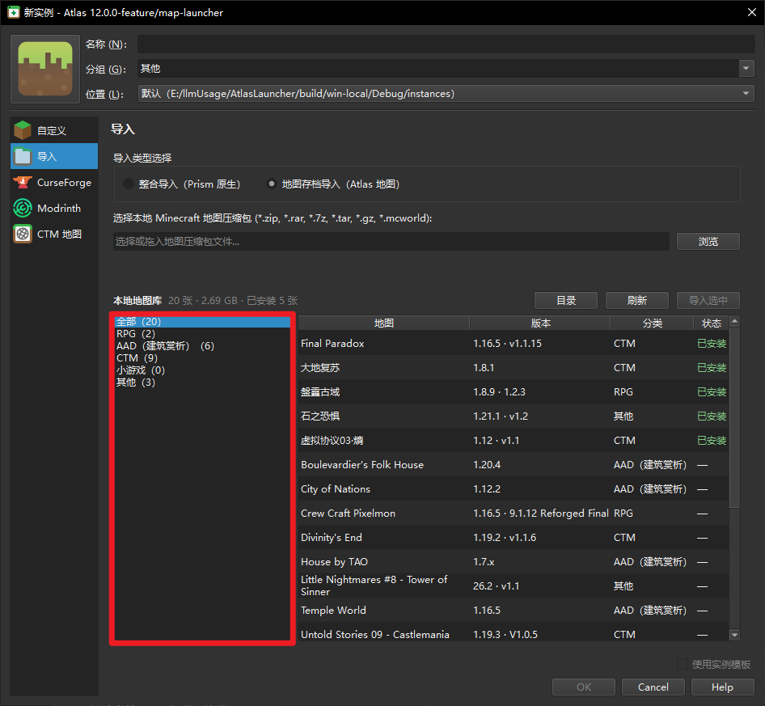

# 05 · 验证记录

> 这个项目最常见的误判是**把"编译过了"当成"能用"**：符号表逐槽位校准过，却没人问过"改写器读不读得动
> 这个 class 版本"（[06 §81](06-变更记录.md)）。所以本文只回答一件事：**每项功能验到哪一档、证据是什么**。
> 状态与待办看 [04](04-进度与待办.md)。

---

## 1. 四个档位

| 档 | 含义 | 能证明什么 | 不能证明什么 |
| --- | --- | --- | --- |
| **L0 编译** | Debug / Release 构建通过 | 语法、链接、资源打包 | 任何运行时行为 |
| **L1 单测 / 静态审计** | `ctest`、夹具回归、符号表对 jar 复核 | 纯函数、数据格式、映射表、字节码槽位存在 | 真实网络、真实游戏、界面观感 |
| **L2 真实产物** | 拿真实 client jar 跑改写、真实站点跑通道、真实网络下载 | 工具链版本对得上、协议/映射对得上 | 游戏内是否真的进图 |
| **L3 真机** | 玩家在 `atlas.exe` 里操作，游戏真的启动 | 端到端可用 | 别的版本/别的网络也成立 |

**写法约定**：写"通过"必须带档位与范围（"1.19.3 真机通过" ≠ "1.19.x 全部通过"）。

---

## 2. 验证矩阵

| 功能 | 档 | 日期 | 范围 / 证据 |
| --- | --- | --- | --- |
| 识别 + 三级判定 | L1 | 10-31 起持续 | 23 个 AIO 夹具逐项一致（版本/置信度/世界数/资源包数）；26.x 拒绝 |
| 导入建实例（zip/rar/7z） | L3 | 11-07 ~ 11-15 | 10 个实例由真实包导入；`map.json` 证据链完整 |
| 大包导入不假死 | L3 | 11-07 | 162 MB 包异步解压、可取消 |
| 1.20+ 点卡片进图 | L3 | 11-03 / 11-15 | 1.21.1；`[US9] Castlemania` 1.19.3 走的是 Agent 轨道 |
| introskip 跳过确认页 | L3 | 11-03 21:49（1.21.1）、11-15 17:39（1.19.3） | 日志 `已跳过确认页`，3–9 秒后进图 |
| introskip 1.21.9（原版） | L3 | 11-19 23:20 | 用户确认：点卡片直接进图、确认页不再出现 |
| introskip 其余版本 | L2 | 11-15 | 1.19 / 1.19.1 / 1.19.2 / 1.19.4 对真实类改写成功；1.20–1.21.11 除 1.21.1 / 1.21.9 外只有表，未逐版真机 |
| introskip 表全量复核 | L1 | 11-19 23:00 | 25 条逐条对真实 client jar：类存在、方法名+描述符精确命中、描述符形状唯一（`shape=1`）；新增 1.21.6–1.21.11 六条由官方 `client_mappings` 生成 |
| introskip 的 Fabric 支持 | L3 | 11-19 22:02 | Fabric 1.21.1（68 模组）实机：`introskip-480073ec50c38153.log` 记 `ftm → net/minecraft/class_7196`，24 秒后 `已跳过确认页`；确认页不再出现 |
| Agent 进图 + 安全退出 | L3 | 11-08 / 11-15 | 1.8.9、1.12（Forge `[SP03] Entropy`）、1.16.5、1.19.3：秒进世界 → Esc 保存退出 → 游戏自退 |
| Agent 其余 55 张表 | L1 | 11-08 | 每槽位对真实 client jar 校验（`agent-matrix.md`），**没启动过游戏** |
| ASM 9.7.1 改写 Java 17 类 | L2 | 11-15 | `epg.b()V`、`MinecraftServer.a(ZZZ)Z` 改写成功；旧 jar 抛 `IllegalArgumentException` |
| 1.20+ 退出即关 | L3 | 11-03 / 11-15 | 1.21.1 连开两次；1.19.3 日志 151.5s `player left the world` → 155.6s 关窗 |
| 1.21.1 Fabric 实例的退出即关 | L0 | 11-19 22:30 | 已改：watcher 挂载不再要求 `autoEnter`，实例 `MapSafeExit=true`；Fabric 日志里两个 marker 都在，**未复验** |
| 退出即关的强制结束回退 | L0 | 11-17 | 回退通道改走 `Application::forceKill`（不弹确认框）；**没真机复验**（[04 P2 #28](04-进度与待办.md)） |
| 封面加载器 / 浏览器通道的看门狗收尾 | L0 | 11-17 | killer 提为成员、三条收尾路径统一停表；换 NAM 时复位状态机。行为只能靠日志观察 |
| 导入 / 重装任务析构等待 | L0 | 11-17 | 析构置 abort 位并 `waitForFinished()`；导入流程未重跑 |
| 分片下载 / 续传 | L3 | 11-05 ~ 11-06 | 同文件 368 KB/s → 2998 KB/s；断点续传、服务器无视 Range 退单连接都实跑过 |
| 看门狗（空闲 / 吞吐） | L2–L3 | 11-06 | 真实网络探针；实测一个请求曾挂 3542 秒，加表后 20 秒掐断 |
| BMCLAPI 换源 | L3 | 11-04 | 官方 `Connection closed`、镜像 200；连通性测试四项逐条 |
| 本地离线优先启动 | L3 | 11-08 | 已装实例不再拉 `index.json`，秒开 |
| 资源库换目录 | L3 | 11-14（修后复验） | 指向共享库；不重下、不 `ClassNotFoundException`（当前根见 [04 §5.4](04-进度与待办.md)） |
| 素材索引按 sha1 复用 | L0–L1 | 11-19 | 新增 `AssetIndexCache` 5 项用例（命中 / 同大小换内容 / 截断 / 缺失 / 无 sha1）；"上游换索引 → 重下清单"真机实测（11-19 18:20，1.21.1），"命中时跳过下载"待复验（§3 #23） |
| 大厅整库（2287） | L2 | 11-14 / 11-15 | 浏览器通道 3.6 s 拿 2287 行（Release）；本地缓存 list = details |
| 大厅界面（搜索/详情/评论） | L3 | 11-01 ~ 11-15 | 玩家实际使用 |
| 大厅失败页改版 | L0–L1 | 11-15 | 只过编译与测试；本机无截图能力，**版面未复看** |
| 本地地图库（分类/已安装/拖拽） | L3 | 11-09 / 11-10 | 真机反馈 4 条闭环（§4） |
| 地图库重命名 / 站上关联 | L0 | 11-17 | 只过编译与既有套件（当时 31）；**新菜单与对话框没在真实窗口点过** |
| 大厅详情面板滚动条 | L0 | 11-17 | 只改样式（细滑杆、无轨道箭头），**观感未复看** |
| 地图库两层模型 + 两轮排版 | L0–L1 | 11-14 / 11-15 | 折叠 / 三级右键 / 列宽记忆 / 92px 栏 / 系列标签**没在真实窗口点过** |
| 资源包挂载 | L1 | 11-14 | 12 项单测；**没在真机挂过** |
| 导入对话框 9 项设置 | L1 | 11-15 | `MapOptionsTxt` 37 项；**复选框没点过** |
| 模组预设 | L3 | 11-15 | 用户确认"基本可用"；观感未复看 |
| Debug 共用便携数据根（`--dir`） | L2 | 11-19 | 日志 `Adjusted by: "Command line"`、数据根 = `E:/Program File/AtlasLaucher`、10 个实例、账号刷新、`Got translation: "zh"`、主题 `Fusion`；`run-atlas-debug.cmd` 本身没跑过（工具策略不允许从会话里起 `cmd.exe`），验的是等价命令行 |
| 便携包 | L2 | 11-15 / 11-19 | 11-15 开发机解压直跑；11-19 正式装到 `E:/Program File/AtlasLaucher`，从 Debug 剪切 10 个实例 + 26 个地图包 + 大厅缓存（2287 行）后启动：`Adjusted by: Portable data path`、10 个实例、`zh` 语言、账号与 `metacache` 齐；**干净机器仍未验**（#10） |
| 按版本选 Java（`JavaRecommend`） | L1 | 11-19 | 11 项纯函数用例：版本表边界（1.20.4/1.20.5、26.1）、固定路径优先、meta 点名运行时优先、无匹配不降级、32 位靠后；导入与启动的写入路径只过编译 |
| 便携包携带 Java 检查器（`jars/`） | L2 | 11-19 | 修「任何实例都起不来 + 检测挂死」（[06 §99](06-变更记录.md)）：`cmake --install --component Runtime` 输出三个 jar；`javaw -jar JavaCheck.jar` 回三行属性；新包 34 项 / zip 18.6 MB，含 `jars/JavaCheck.jar`；实例侧靠 `<exe>/jars` 命中。**真实窗口点「检测」/「启动」待复验**（[04 P0 #7](04-进度与待办.md)） |

---

## 3. 未验证清单（诚实版）

| # | 事项 | 现状 | 怎么验 |
| --- | --- | --- | --- |
| 1 | **1.17 / 1.18 自动进图** | 设计上不支持：没有 `WorldOpenFlows`，只剩旧扫描 | 不需要验；要么补 `doWorldLoad` 装配（有坏档风险），要么接受停主菜单 |
| 2 | 1.19 / 1.19.1 / 1.19.2 / 1.19.4 的 introskip | 只到"对真实类改写成功" | 各导一张带数据包的地图，看是否弹确认页 |
| 3 | 59 张符号表里 55 张 | 只到"槽位在真实 jar 里查得到" | 每个主流版本至少跑一次"进图 + 退出"；优先 1.7.10 / 1.12.2 / 1.13.2 / 1.18.2 |
| 4 | 1.20+ 全量 trait 覆盖 | 代码按 trait 判，只真机跑过 1.21.1 | 抽查 1.20.2 / 1.20.6 / 1.21.9 |
| 5 | RAR5 / 分卷 / 加密头 | 夹具只有小 RAR | 拿一个分卷 RAR5 导入；失败看提示是否可执行 |
| 6 | 资源包挂载 | 12 项单测通过 | 一份真实中文资源包 + 一个启动过的实例；挂完进游戏看资源包列表；再挂一次不重复 |
| 7 | 导入对话框 9 个复选框 | 逻辑有 37 项单测，界面没点过 | 1.16.5 与 1.8.9 各导一次，逐行比对 `options.txt` |
| 8 | 地图库界面 6+1 项 | 11-14 之后只有编译与测试 | 见 [04 §4 P0](04-进度与待办.md) |
| 9 | 大厅失败页版面 | 只过编译 | 断网截图，看标题/建议/按钮间距/折叠区对齐 |
| 10 | 干净机器跑便携包 | 开发机已正式安装（9 实例、中文、账号、大厅缓存都在），干净机器未试 | 无 VS / Qt / vcpkg 的机器：解压 → 起窗口 → 点卡片进图 → 退出关窗 |
| 11 | 资源迁移"旧目录删除失败"分支 | 那次删除成功，异常分支没走到 | 把旧目录设只读再迁移，看提示 |
| 12 | 库目录是网络盘 / 只读 | `QSaveFile` 会失败，界面只弹一次警告 | 指到只读目录，确认不会丢索引 |
| 13 | 大包 Debug 解压性能 | 162 MB 约 700 region 要 3–5 分钟 | 别把 Debug 当产品性能；用 Release 量 |
| 14 | 1.20+ 退出日志措辞 | 只按 1.21.1 的实际措辞匹配 | 换版本时看是否退化成"10 秒后关"（仍能关） |
| 15 | 分片降级后仍慢 | 不记忆 host，下次仍先试满段数 | 观察 `libraries` 的 fastutil / piston-data 的 client.jar |
| 16 | 大厅首次打开 12 秒 / 50 张封面取不到 | 无头浏览器一批 8 张；`ctmrepository.com` 被 Cloudflare 挡 | 加批量或并发；封面换源 |
| 17 | 改名产生孤儿条目 | 实测过一次（`Ragecraft III`），已手工修；界面无提示 | 改名后刷新，看是否提示"有 N 个包不在索引里" |
| 18 | 退出即关的强制结束回退 | 只过编译 | 1.20+ 地图走一次「退出存档 → 游戏自己关」；再造一次"游戏不回 `WM_CLOSE`"的场面（长任务卡住退出），确认 8 秒后被结束且**没有**弹确认框 |
| 19 | 封面加载器换 NAM / 页面关闭 | 只过编译 | 打开大厅 → 封面还在转时关掉窗口 → 再打开：封面应继续加载（旧代码会永久停摆） |
| 20 | 地图库重命名 / 关联对话框 | 只过编译 | 组标题改名 → 折叠/展开后仍是新名 → 重启启动器仍在；独立图改名；「关联到 CTM 地图站条目…」按名字过滤并选一条，确认图变绿/工具提示不再写「未确认」 |
| 21 | 详情面板滚动条观感 | 只过编译 | 深色 + 浅色两套主题各看一次：右缘应只有一根细滑杆、无箭头无轨道，内容仍可滚 |
| 22 | Java 推荐组与自动写入 | 逻辑有 11 项单测，界面与两条写入路径（导入 / 启动）没真机走过 | 1.16.5 与 1.21.1 各导一张：看「需要 / 当前 / 推荐」是否对得上；点「使用选中的 Java」→ 重启启动器仍是该值；关掉 `MapAutoJava` 后启动，实例 Java 不被改写；日志出现 `Map java:` |
| 23 | **索引命中时真的不发请求** | 只到 L1；便携版 11-19 已装好，但还没在它上面点图，跳过分支的日志与下载面板都没看过 | 启动一个素材已下全的实例（如 1.16.5 的 `Bitstream`）：`Atlas-0.log` 应出现 `Asset index already matches its sha1, skipping download:`，下载面板不应再出现「资源索引」任务；再启动一次 1.21.1，`17.json` 也不该重下 |

---

## 4. 真机反馈闭环（2026-11-09 / 11-10）

| # | 反馈 | 结论 |
| --- | --- | --- |
| 1 | 左栏分类太宽（约 230px），`分类` 列被截断 | 固定 132px + 纯英文短名；2026-11-15 进一步收到 **92px 并改等宽** |
| 2 | 打开导入页弹 CurseForge 网络错误模态框 | 轻量 API `askRetry=false` + `maxTries=1`，失败在页面内就地提示 |
| 3 | 分类名要纯英文、归类方式可扩展 | 方案 B：`map-library.json` 存 `categories`，界面 `+`/`-` 与右键增删改；删分类并入 `Other` |
| 4 | 重装地图强制备份 | 改为可选（默认勾选）+ 中文「是/否」；解压校验通过后才处置旧存档 |

未闭环（不阻塞）：14 条索引中文名为空；`Smaller CTM` 已于 2026-11-19 随实例删除，该项作废。

---

## 5. 环境问题与排除

### 5.1 窗口模式一片白（已恢复，非启动器）

2026-11-12 查实：游戏在跑、帧率正常、F2 截图内容正确，但窗口永远白；切全屏正常。纯原版命令行
（不过 Atlas、不过 NewLaunch、不挂 agent）同样复现，换 JDK、换 1.8.9 / 1.21.1 / 1.21.10 都一样 →
机器侧问题（可疑项 RTSS、向日葵 / ToDesk 虚拟显示驱动、AMD 26.3）。**11-13 复查已正常**，
`MapStartFullscreen` 退回纯偏好项。

### 5.2 视角顶死 / 狂转（不是启动器）

成因是远程控制软件的虚拟显示器 + 输入注入（[03 §4](03-决策与坑.md)）。排查顺序固定：
断开远控 → 官方启动器跑同一个原版实例 → 才怀疑启动器。

### 5.3 "卡住"有三种形态，日志不同

| 形态 | 日志 | 对策 |
| --- | --- | --- |
| 连接被掐 | `Connection closed` | 续传（`.part`） |
| 死连接 | `No response in 20 seconds` / `Transfer idle for 20 seconds` | 空闲看门狗掐掉重试 |
| 龟速 | `Download is crawling at` / `Range N is crawling at` | 吞吐看门狗换连接；分片按片续 |

同机实测：官方域 `Connection closed`、BMCLAPI 直连 200；BMCLAPI 302 到随机节点，单次成功率 30–50%；
带宽按连接分配（1 条 60 KB/s、8 条 487 KB/s、32 条 1.19 MB/s）；`libraries.minecraft.net` 自己也在
30 KB/s–1.2 MB/s 之间摆。**看到"只有 60 KB/s"先量一下再怀疑启动器**。

---

## 6. 证据索引

| 想看什么 | 去哪 |
| --- | --- |
| 某次启动走了哪条轨道、为什么 | `Atlas-0.log` 搜 `Map launch plan:` |
| 退出看门狗挂上没、关窗没 | 搜 `Map quit watcher:` |
| 前台交接 | 搜 `Map window focus:` |
| Agent 进图与落盘 | 实例目录 `agent.log`：`ENTER_WORLD_OK` / `SAVE_DONE (quit save)` / `EXIT_SAFE` |
| 是否跳过确认页 | `<数据目录>/agents/introskip-<hash>.log`：`已跳过确认页` |
| 启动/导入时选了哪个 Java、为什么 | `Atlas-0.log` 搜 `Map java:`（自动选用会带理由；没改会说明原因） |
| 下载分段 / 重试 / 续传 | `Splitting … into N ranges`、`Request failed … retrying from`、`Resuming … from byte N` |
| 这次启动要不要重下素材清单 | 搜 `Asset index already matches its sha1`（命中，跳过）或 `Asset index SHA1:`（没命中，正在下） |
| 符号表覆盖 | [`agent-matrix.md`](agent-matrix.md)（脚本生成，别手改） |
| 每项改动的来龙去脉 | [06](06-变更记录.md)（§2–§97，编号可被代码与提交引用） |
| 2026-11-17 审查的原始过程 | [`审查清单-2026-11-17.md`](审查清单-2026-11-17.md)（归档；结论在 06 §89） |

> 日志会滚动：每次启动把 `Atlas-0.log` 变成 `Atlas-1.log`，文档里写"当时 `Atlas-0.log`"指的是那一次
> 会话的最新日志，事后要按时间找。
