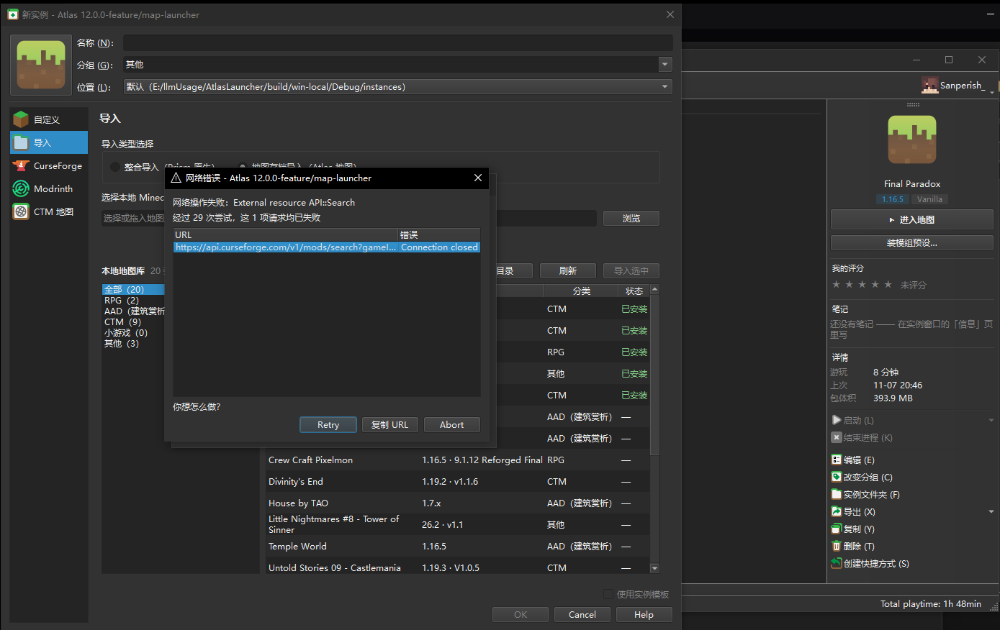

# 05 · 验证记录

> 这个项目最常见的误判是**把"编译过了"当成"能用"**：符号表逐槽位校准过，却没人问过"改写器读不读得动
> 这个 class 版本"（[06 §81](06-变更记录.md)）。所以本文只回答一件事：**每项功能验到哪一档、证据是什么**。
> 状态与待办看 [04](04-进度与待办.md)。

---

## 1. 四个档位

| 档 | 含义 | 能证明什么 | 不能证明什么 |
| --- | --- | --- | --- |
| **L0 编译** | Debug / Release 构建通过 | 语法、链接、资源打包 | 任何运行时行为 |
| **L1 单测 / 静态审计** | `ctest`、夹具回归、符号表对 jar 复核 | 纯函数、数据格式、映射表、字节码槽位存在 | 真实网络、真实游戏、界面观感 |
| **L2 真实产物** | 拿真实 client jar 跑改写、真实站点跑通道、真实网络下载 | 工具链版本对得上、协议/映射对得上 | 游戏内是否真的进图 |
| **L3 真机** | 玩家在 `atlas.exe` 里操作，游戏真的启动 | 端到端可用 | 别的版本/别的网络也成立 |

**写法约定**：写"通过"必须带档位与范围（"1.19.3 真机通过" ≠ "1.19.x 全部通过"）。

---

## 2. 验证矩阵

| 功能 | 档 | 日期 | 范围 / 证据 |
| --- | --- | --- | --- |
| 识别 + 三级判定 | L1 | 10-31 起持续 | 23 个 AIO 夹具逐项一致（版本/置信度/世界数/资源包数）；26.x 拒绝 |
| 导入建实例（zip/rar/7z） | L3 | 11-07 ~ 11-15 | 10 个实例由真实包导入；`map.json` 证据链完整 |
| 大包导入不假死 | L3 | 11-07 | 162 MB 包异步解压、可取消 |
| 1.20+ 点卡片进图 | L3 | 11-03 / 11-15 | 1.21.1；`[US9] Castlemania` 1.19.3 走的是 Agent 轨道 |
| introskip 跳过确认页 | L3 | 11-03 21:49（1.21.1）、11-15 17:39（1.19.3） | 日志 `已跳过确认页`，3–9 秒后进图 |
| introskip 1.21.9（原版） | L3 | 11-19 23:20 | 用户确认：点卡片直接进图、确认页不再出现 |
| introskip 其余版本 | L2 | 11-15 | 1.19 / 1.19.1 / 1.19.2 / 1.19.4 对真实类改写成功；1.20–1.21.11 除 1.21.1 / 1.21.9 外只有表，未逐版真机 |
| introskip 表全量复核 | L1 | 11-19 23:00 | 25 条逐条对真实 client jar：类存在、方法名+描述符精确命中、描述符形状唯一（`shape=1`）；新增 1.21.6–1.21.11 六条由官方 `client_mappings` 生成 |
| introskip 的 Fabric 支持 | L3 | 11-19 22:02 | Fabric 1.21.1（68 模组）实机：`introskip-480073ec50c38153.log` 记 `ftm → net/minecraft/class_7196`，24 秒后 `已跳过确认页`；确认页不再出现 |
| Agent 进图 + 安全退出 | L3 | 11-08 / 11-15 / 11-20 | 1.8.9、1.12（Forge `[SP03] Entropy`）、1.16.5、1.19.3、1.9.4：秒进世界 → Esc 保存退出 → 游戏自退 |
| Agent 进图 1.9.4（三参入口） | L3 | 11-20 18:15 | `Bdub_1.9`（HIGH 判定）：`Map launch plan: track=1`（Agent）→ `launch=a desc=(Ljava/lang/String;Ljava/lang/String;Lahw;)V` → `+7270ms ENTER_WORLD_OK`（进图 1.6 秒）→ `SAVE_DONE #4 (quit save)` → `EXIT_SAFE by=player via=menu2`；`playSeconds=291`。这是**1.9 代三参入口**（`a(String,String,Lahw;)V`）首次真机，与 1.19+ 的 `WorldOpenFlows.loadLevel` 不是同一条路 |
| Agent 其余 54 张表 | L1 | 11-08 | 每槽位对真实 client jar 校验（`agent-matrix.md`），**没启动过游戏**（1.9.4 已于 11-20 转 L3，见上） |
| ASM 9.7.1 改写 Java 17 类 | L2 | 11-15 | `epg.b()V`、`MinecraftServer.a(ZZZ)Z` 改写成功；旧 jar 抛 `IllegalArgumentException` |
| 1.20+ 退出即关 | L3 | 11-03 / 11-15 | 1.21.1 连开两次；1.19.3 日志 151.5s `player left the world` → 155.6s 关窗 |
| 1.21.1 Fabric 实例的退出即关 | L0 | 11-19 22:30 | 已改：watcher 挂载不再要求 `autoEnter`，实例 `MapSafeExit=true`；Fabric 日志里两个 marker 都在，**未复验** |
| 退出即关的强制结束回退 | L0 | 11-17 | 回退通道改走 `Application::forceKill`（不弹确认框）；**没真机复验**（[04 P2 #28](04-进度与待办.md)） |
| 封面加载器 / 浏览器通道的看门狗收尾 | L0 | 11-17 | killer 提为成员、三条收尾路径统一停表；换 NAM 时复位状态机。行为只能靠日志观察 |
| 导入 / 重装任务析构等待 | L0 | 11-17 | 析构置 abort 位并 `waitForFinished()`；导入流程未重跑 |
| 分片下载 / 续传 | L3 | 11-05 ~ 11-06 | 同文件 368 KB/s → 2998 KB/s；断点续传、服务器无视 Range 退单连接都实跑过 |
| 看门狗（空闲 / 吞吐） | L2–L3 | 11-06 | 真实网络探针；实测一个请求曾挂 3542 秒，加表后 20 秒掐断 |
| BMCLAPI 换源 | L3 | 11-04 | 官方 `Connection closed`、镜像 200；连通性测试四项逐条 |
| 本地离线优先启动 | L3 | 11-08 | 已装实例不再拉 `index.json`，秒开 |
| 资源库换目录 | L3 | 11-14（修后复验） | 指向共享库；不重下、不 `ClassNotFoundException`（当前根见 [04 §5.4](04-进度与待办.md)） |
| 素材索引按 sha1 复用 | L0–L3 | 11-19 / 11-20 | 新增 `AssetIndexCache` 5 项用例（命中 / 同大小换内容 / 截断 / 缺失 / 无 sha1）；"上游换索引 → 重下清单"真机实测（11-19 18:20，1.21.1），待复验（§3 #23）。**11-20 18:20 复验（L3，便携版）**：启动 1.9.4 时两处出现 `Asset index already matches its sha1, skipping download: "…/assets/indexes/1.9.json"`，索引任务不再进下载面板 |
| 大厅整库（2287） | L2 | 11-14 / 11-15 | 浏览器通道 3.6 s 拿 2287 行（Release）；本地缓存 list = details |
| 大厅界面（搜索/详情/评论） | L3 | 11-01 ~ 11-15 | 玩家实际使用 |
| 大厅失败页改版 | L0–L1 | 11-15 | 只过编译与测试；本机无截图能力，**版面未复看** |
| 本地地图库（分类/已安装/拖拽） | L3 | 11-09 / 11-10 | 真机反馈 4 条闭环（§4） |
| 地图库重命名 / 站上关联 | L0 | 11-17 | 只过编译与既有套件（当时 31）；**对话框本身没在真实窗口点过**（11-24 只确认了右键菜单的文案与归属，见下行） |
| 大厅详情面板滚动条 | L0 | 11-17 | 只改样式（细滑杆、无轨道箭头），**观感未复看** |
| 地图库两层模型 + 两轮排版 | L0–L1（折叠与系列标签已升 L3） | 11-14 / 11-15 | 折叠（含系列默认收起）与系列标签（`[RC3]` → `Ragecraft 3`）**已于 11-22 晚真机复看通过**；三级右键与列宽记忆 **11-24 复看通过**；92px 分类栏未单独取证 |
| 本地库页 / 系列两层 / 右键删除 | L0（系列部分已升 L3） | 11-22 | Release 装机后**界面看得到**；系列展开收起、`[MW7]` 缩写、系列聚合列**已于 11-22 22:45 用户复看通过**（见下行）。删除拒绝 **11-23 验过**，右键归属与菜单文案 **11-24 复看通过**；打开目录选中文件仍未单独取证（[05 §3 #27](#3-未验证清单诚实版)） |
| 大厅 ↔ 本地库 / 评论优先缓存 | L0 | 11-22 | 只过编译；「已入库」chip、`从本地库导入` 多版本菜单、以及"断网时评论只降级不顶页"都还没在窗口里复现过 |
| 资源包挂载 | L1 | 11-14 | 12 项单测；**没在真机挂过** |
| 导入对话框 9 项设置 | L0–L1 → **L3** | 11-15 / 11-23 | `MapOptionsTxt` 37 项；11-23 在 0.1.0 上 1.16.5 与 1.8.9 各导一次，逐行对过 `options.txt`（[08](08-真机复看清单.md) C） |
| 模组预设 | L3 | 11-15 | 用户确认"基本可用"；观感未复看 |
| Debug 共用便携数据根（`--dir`） | L2 | 11-19 | 日志 `Adjusted by: "Command line"`、数据根 = `E:/Program File/AtlasLaucher`、当时 10 个实例、账号刷新、`Got translation: "zh"`、主题 `Fusion`；`run-atlas-debug.cmd` 本身没跑过（工具策略不允许从会话里起 `cmd.exe`），验的是等价命令行 |
| 部署脚本 `deploy-local.ps1` | L2 | 11-20 00:12 | 三种用法实跑：`-DryRun`（体检，报 9 个实例会保留）、`-SkipBuild`（重打包 + 覆盖）、默认（构建 + 打包 + 覆盖）；构建 / 包 / 安装目录三处 exe 的 SHA-256 一致；覆盖后 `instances` 仍是 9 个 |
| 便携包 | L2 | 11-15 / 11-19 | 11-15 开发机解压直跑；11-19 正式装到 `E:/Program File/AtlasLaucher`，从 Debug 剪切当时 10 个实例 + 26 个地图包 + 大厅缓存（2287 行）后启动：`Adjusted by: Portable data path`、10 个实例、`zh` 语言、账号与 `metacache` 齐；**干净机器仍未验**（#10） |
| 按版本选 Java（`JavaRecommend`） | L1–L3 | 11-19 / 11-20 | 11 项纯函数用例：版本表边界（1.20.4/1.20.5、26.1）、固定路径优先、meta 点名运行时优先、无匹配不降级、32 位靠后。**导入写入路径 L3**（11-20）：1.9.4 导入时日志 `Map java: … 选用 jre-legacy/bin/javaw.exe … 1.9.4 使用 Java 8`，实例 `instance.cfg` 落成 `OverrideJavaLocation=true / AutomaticJava=true`；启动时未再改写（已匹配，无日志）。界面下拉与「使用选中的 Java」**11-24 复看通过**（[04 P0 #7](04-进度与待办.md)） |
| 便携包携带 Java 检查器（`jars/`） | L2 | 11-19 | 修「任何实例都起不来 + 检测挂死」（[06 §99](06-变更记录.md)）：`cmake --install --component Runtime` 输出三个 jar；`javaw -jar JavaCheck.jar` 回三行属性；新包 34 项 / zip 18.6 MB，含 `jars/JavaCheck.jar`；实例侧靠 `<exe>/jars` 命中。**真实窗口点「检测」/「启动」待复验**（[04 P0 #7](04-进度与待办.md)） |
| 小文件分段（1 MiB 起，段数按体积） | L0–L1 | 11-21 | `chunkCountFor` / `splitChunks` 两条纯函数用例：1 MiB→2 段、2.56 MiB→6 段、8 MiB→16 段、切段首尾相接且覆盖整份；**真机下载未验**（下一次装包看日志 `Splitting 2684354 bytes into 6 ranges`，面板显示 `×6`） |
| 停滞状态可见 + 10 秒窗口 | L0 | 11-21 | 只过编译与套件。面板「重试 n/3」「无响应」、汇总行「N 个在重试」、以及"已停滞过 → 10 秒"都要下一次弱网下载才看得见；**未验** |
| 改实例目录名（先停监视器） | L0–L2 | 11-21 | 机制用 .NET 在临时目录复现：`FileSystemWatcher` 挂在子目录 → 父目录 `Directory.Move` 被拒绝；`FileShare.Delete` 打开子文件同样被拒绝；Dispose 后成功。安装目录 `The WesterosCraft Modpack 2.1.0` → `WesterosCraft` **确已改成功**（目录名与 `name=` 都变了）；停/启监视器改成 `MinecraftInstance` 普通成员后的版本**待再点一次** |
| 启动不再无声退出（11-21 回归） | L2 | 11-21 17:20 | `atlas.exe --launch ArdaCraft`（安装目录）：`Java checker` 用 runtime-gamma（17.0.15）通过，`LauncherPartLaunch` 拼出 1.20.1 + Fabric + 81 模组的完整 classpath；进程活到 120 秒（rc=124，`timeout` 掐掉），修复前是 **rc=139 段错误**。`ctest` 33/33、445 项 |
| 导入图标提取顺序 + 重装回填 | L0–L2 | 11-22 17:35 | 提取挪到 `importIntoLibrary()` 之前、移动成功后 `m_archivePath` 指向库副本、`reinstallWorlds()` 在缺图标时补一次；Debug 增量构建通过，`ctest` **33/33**（20.8 秒）。数据侧：从 5 个实例的 `archive.libraryCopy` 回填 `icon.png` 并逐个验过 PNG 魔数，10 个地图实例现有 7 个带图标。Release 包 18.7 MB 已覆盖安装（三处 exe 哈希一致，[06 §109](06-变更记录.md) 五）。**新导入与重装两条代码路径没在窗口里点过**，也没有自动化用例（[04 P2 #30](04-进度与待办.md)、[#32](04-进度与待办.md)） |
| 审查整改第一轮（并发 / 生命周期 / UI 阻塞） | L0–L2 | 11-22 19:45 | `HallCache` 加锁 + 导入登记回 UI 线程、两个静态单例改挂 `qApp`、关窗持进程句柄、`BrowserFetch` 异步清理、扫描/迁移移出 UI 线程、abort 检查、封面缓存清理入口。Debug 全量构建通过、`ctest` **33/33**（20.3 秒，收尾那次）、Release 已覆盖安装（三处 exe 哈希一致，[06 §110](06-变更记录.md)）。**并发压测、退出 timer 警告、3 GB 迁移观感都没验** |
| 本地库系列行与树形折线（11-22 晚） | **L3** | 11-22 22:45 | 期号缺省按 1（`[US]` → `[US1]`）、系列行版本/语言写「~」、组内中间「├」最后「└」：装机后**用户看真实窗口确认「效果非常不错」**（[06 §112](06-变更记录.md)）。L1 侧 `MapSeriesNames` 新增 3 个用例，`ctest` 33/33（19.8 秒，438 / 0 / 10 = 448 项） |
| CTMMaps 简介页空隙 + 文案收敛（11-23） | L0–L1 | 11-23 13:25 | 17 处提示语收敛（见 [06 §116](06-变更记录.md) 的表）；简介页两张卡片间的 ~100px 空白**没修**，先加了一行 `qInfo`（关键字 `Map hall about:`）打印滚动体里每个 item 的类型与几何 —— 同样布局在离屏窗口里复现不出空隙，等真机日志。构建通过、`ctest` 33/33（448 项）、已装机。**文案与日志都没在窗口里看过** |
| 地图行菜单补齐（11-22 晚二轮） | L0–L1 | 11-22 23:20 | 组菜单补「导入 / 语言标签… / 地图版本…」（单包直连、多包子菜单），删掉悬空的 `showVersionContextMenu` 与 `kChildRowRole`；Debug 构建通过、`ctest` 33/33（21.9 秒）。**新菜单项没在窗口里点过**（[06 §113](06-变更记录.md)） |
| 「打开所在目录」按默认文件管理器分派（11-22 晚三轮） | L0–L2 | 11-22 23:45 | 旧写法 `explorer.exe /select,<路径>` 在带空格路径上被 Qt 整段加引号 → explorer 解析失败退回「文档」；且硬编码 explorer 绕开了 `HKCR\Folder\shell` 的默认动词（这台机器是 `openindopus`）。现在 DOpus → `dopusrt /cmd Go "<文件>"`；资源管理器/无动词 → `SHOpenFolderAndSelectItems`；其它 → 外壳开目录。注册表侧核对过，`dopusrt` **没有实际执行**（沙箱限制），**真机未点**（[06 §114](06-变更记录.md)） |
| DOpus 用 OPENCONTAINER + 子菜单改文件名（11-23） | L0–L2 | 11-23 12:15 | 真机发现两处：`Go "<zip>"` 在 DOpus 里**进到压缩包内部**（DOpus 把 zip 当文件夹）→ 改 `Go OPENCONTAINER PATH "<文件>"`；组菜单子菜单两行都是 `v1.0 简中`（同一张图的两个汉化包标签相同）→ 改写字**文件名**，顺手删掉失去引用的 `versionLabel/languageTag`（38 行）。构建通过、`ctest` 33/33（27.3 秒）、已装机（12:17，13,061,120 字节）。**这两处都还没点过**（[06 §115](06-变更记录.md)） |
| 发布包合规：许可证 / 第三方声明 / 包内说明 / 中文翻译（11-23） | L0–L2 | 11-23 19:00 | `Atlas-0.1.0-win64-release.zip` 42 条目 / 18.8 MB：`LICENSE.txt`、`COPYING.md`、`THIRD-PARTY-NOTICES.md`、`README-Atlas.txt`、`translations/{mmc_zh,qt_zh_CN,qtbase_zh_CN}.qm`；打包脚本缺文件即 throw。`ctest` 33/33（22.85 s / 21.34 s）。**干净机器解压首跑、包内说明可读性、中文标准对话框都没看过** |
| 版本线 0.1.0 + 关于页免责与链接（11-23） | L0–L2 | 11-23 19:00 | `BuildConfig` 里 `USER_AGENT="Atlas/0.1.0"`；zip 名随版本；configure 打印 `About dialog URL (from origin): https://github.com/xwk6661/PrismLauncher`。**关于页文案与 Issues 链接未在窗口里看过** |
| 外人能编：BUILDING.md + 预设示例（11-23） | L0 | 11-23 19:00 | 只写了文档与示例文件，**没有第二台机器照做过**；本机仍走 `build\` 里那套脚本 |
| 四项真机复看：删除拒绝 / 规范命名后重装 / 九项 `options.txt` / 1.20+ 直连（11-23） | **L3** | 11-23 | 0.1.0 便携版上作者逐项确认可行（步骤与判定见 [08](08-真机复看清单.md)）：已安装的包删除被拒并列出实例、改名后重装找得到源包、1.16.5 与 1.8.9 的 `options.txt` 与九项标签一致、1.20+ 点卡片进图且退出后游戏自己关窗。**其他版本（1.7.10 / 1.12.2 / 1.13.2 / 1.18.2 …）未做**，全面化测试后置 |
| 与上游解耦（11-23） | L0–L2 | 11-23 20:30 | 11 个 URL 置空、翻译索引不再下载、帮助与社区入口隐藏、`prismlauncher://` → `atlas://`；`BuildConfig.cpp` 逐项核对、`ctest` 33/33、包已装机。**窗口里没看过菜单是否干净**，启动日志也没确认"没有 `Downloading Translations Index...`" |
| 仓库规范化（11-23） | — | 11-23 21:00 | 不是产品功能，属工程操作：默认分支 `main`、删 23 个残留分支、Issues/Discussions、`main` 禁强推禁删、issue/PR 模板。核对方式为 `gh repo view` / `gh api rulesets`（[07 §7.3](07-发布清单.md)） |
| 大厅关联批量确认页（11-24） | L0 | 11-24 | 新增 `HallLinkReviewDialog`：列出 `verified:false` 条目、证据支持的行默认勾选、可改归属/解除；`MapLibrary::applyHallLinkEdits()` 一次读一次写。Debug 编译通过（qrc/链接全绿）。**没开窗口点过**；12 条真实数据未走一遍 |
| 加载器版本选择器（11-24） | L0 | 11-24 | `MapImportDialog` 的加载器版本改为可编辑下拉，按 MC 版本 + 加载器从 `metadataIndex()` 拉列表、默认推荐项；离线可手填。Debug 编译通过。**版本列表在真实 meta 上的填充与「选中值写进 mmc-pack」都没验** |
| 界面国际化词表（11-24） | **L2** | 11-24 20:40 | `AtlasCatalogTranslator` + `atlas_en.json` **901 条**（扫描范围从 `maps/` 扩到整个 `launcher/`，新增 113 条），占位符一致性脚本核对 0 缺、`--check` 0 缺；`atlas_zh.json` 19 条补上游缺译。英文模式实跑：日志 `已加载补充词表 :/i18n/atlas_en.json（901 条）`，`PrintWindow` 抓主窗口与快速设置向导全英文，唯一中文是实例名「盘灵古域」（玩家数据）。**未验**：逐个弹窗切英文复看 |
| 启动语言 / 默认中文（11-24） | **L2** | 11-24 20:35 | 空配置启动：`Loading Application Language File for zh` + `Your language is "zh"`；中文补充词表先装、`mmc_zh` 后装；`PrintWindow` 抓主窗口全中文（添加实例 / 文件夹 / 设置 / 帮助 / 启动 / 结束进程 / 总游玩时长）。`ctest` 33/33（20.55 s / 32.01 s）。**未验**：设置页各页签逐页复看、繁体中文 |
| `[RC3] The Prophecy` 转地图实例（11-24） | **L2** | 11-24 22:58 | 只补 `map.json`（`decidedBy=user`，`playSeconds=95235`），存档与世界目录名不动；`atlas.exe --show` 打开实例窗口，默认页为「地图」，标题 `Ragecraft IV: Underworld`、徽章 `1.20.1 / fabric 0.18.4 / 置信度高`、页签 简介/评论/我的/启动。**未验**：点「进入地图」真正进游戏 |
| P0 复看（#2/#3/#4/#6/#7/#9 剩余项，11-24） | **L3** | 11-24 | 作者逐项确认：三类行右键的文案与归属、列宽记忆、实例网格系列药丸、大厅失败页版面、Java 推荐组（含一键应用与关自动开关后不改写）、三套菜单文案与「已入库」chip、详情页「从本地库导入」。**未覆盖**：打开目录选中文件、重命名 / 关联对话框、详情面板滚动条（[05 §3 #20/#21/#27](05-验证记录.md)） |
| 仓库与上游解绑：删除重建、tag 清空、设置重建（11-25） | L2 | 11-25 13:20 | 重建前快照设置并做 `git bundle`（46 MB，`verify` 通过）；重建后 `gh api` 逐项核对：`fork=false`、`parent=null`、`created_at` 为当天、tag 0、分支 2、规则集 `main-protection` active、features 与 topics 正确；抓页面确认无「forked from / Contribute / Sync fork / ahead-behind」。**未截图存档**（[06 §128](06-变更记录.md)） |
| 对外文档重构与品牌许可补齐（11-25） | L0 | 11-25 13:50 | 只改文档、打包清单与新增模板脚本；脚本内部相对链接自检通过（唯一命中 `../../releases` 已改绝对 URL）。**未构建、未打包、未跑 markdownlint**（[06 §129](06-变更记录.md)） |
| 应用图标换成自绘（11-25） | **L2** | 11-25 18:20 | 原稿 `program_info/org.atlas.Atlas.svg`（地图瓦片 + 等距立方体 + 罗盘）；`genicons.py` 渲染 1024 母图再降采样，生成 `atlas.ico`（16/24/32/48/64/128/256，<256 用 BMP、256 用 PNG）、`atlas.icns`（icp4–ic10 七槽，PNG 载荷）、`_256.png`、`bigsur.svg`（1024 画布、瓦片 80%）。校验：解析 ICO 目录 7 项逐项对尺寸与偏移；ICNS 用 Pillow 读回 1024/RGBA；各尺寸 alpha 边界 `(9,9,247,247)`@256 无裁切。**装机前的坑**：第一次部署后从 exe 资源段解出的还是旧图标 —— `rc.exe` 只按 `.rc` 的时间戳判断，`.ico` 换了不会重编 `.res`；已在 `launcher/CMakeLists.txt` 用 `OBJECT_DEPENDS` 把 `.ico` 挂上，重建后 RT_ICON 变成 `[1128,2440,4264,9640,16936,60612,67624]`（256 那一档是 PNG），解出的 256 px 就是新图。**未验**：真机任务栏 / 关于页 / 安装器图标观感（[05 §3 #36](#3-未验证清单诚实版)） |
| 打包清单新增 `LICENSE-branding.txt`（11-25） | **L2** | 11-25 18:34 | 重新出包：zip **43 条目 / 19,895,240 字节**，包内有 `LICENSE-branding.txt` / `LICENSE.txt` / `README-Atlas.txt`；已覆盖装机（[04 P2 #35](04-进度与待办.md)） |

---

## 3. 未验证清单（诚实版）

| # | 事项 | 现状 | 怎么验 |
| --- | --- | --- | --- |
| 1 | **1.17 / 1.18 自动进图** | 设计上不支持：没有 `WorldOpenFlows`，只剩旧扫描 | 不需要验；要么补 `doWorldLoad` 装配（有坏档风险），要么接受停主菜单 |
| 2 | 1.19 / 1.19.1 / 1.19.2 / 1.19.4 的 introskip | 只到"对真实类改写成功" | 各导一张带数据包的地图，看是否弹确认页 |
| 3 | 59 张符号表里 54 张 | 只到"槽位在真实 jar 里查得到"（1.8.9 / 1.9.4 / 1.12 / 1.16.5 / 1.19.3 已 L3） | 每个主流版本至少跑一次"进图 + 退出"；优先 1.7.10 / 1.12.2 / 1.13.2 / 1.18.2 |
| 4 | 1.20+ 全量 trait 覆盖 | 代码按 trait 判，只真机跑过 1.21.1 | 抽查 1.20.2 / 1.20.6 / 1.21.9 |
| 5 | RAR5 / 分卷 / 加密头 | 夹具只有小 RAR | 拿一个分卷 RAR5 导入；失败看提示是否可执行 |
| 6 | 资源包挂载 | 12 项单测通过 | 一份真实中文资源包 + 一个启动过的实例；挂完进游戏看资源包列表；再挂一次不重复 |
| 7 | ~~导入对话框 9 个复选框~~ | **已关（11-23，L3）**：1.16.5 与 1.8.9 各导一次，逐行对过 `options.txt`（[08](08-真机复看清单.md) C） | — |
| 8 | ~~地图库界面 6+1 项~~ | **已关（11-24）**：删除拒绝与规范命名后重装 11-23；三类行右键的文案与归属、列宽记忆、实例网格药丸、大厅「已入库」chip 11-24 复看通过（[04 §4 P0](04-进度与待办.md) #2/#3/#4/#9） | — |
| 9 | ~~大厅失败页版面~~ | **已关（11-24）**：断网复看通过（[04 P0 #6](04-进度与待办.md)） | — |
| 10 | 干净机器跑便携包 | 🕓 **暂缓（待转交）**：开发机已正式安装（现 15 实例、中文、账号、大厅缓存都在），干净机器未试 | 无 VS / Qt / vcpkg 的机器：解压 → 起窗口 → 点卡片进图 → 退出关窗 |
| 11 | 资源迁移"旧目录删除失败"分支 | 那次删除成功，异常分支没走到 | 把旧目录设只读再迁移，看提示 |
| 12 | 库目录是网络盘 / 只读 | `QSaveFile` 会失败，界面只弹一次警告 | 指到只读目录，确认不会丢索引 |
| 13 | 大包 Debug 解压性能 | 162 MB 约 700 region 要 3–5 分钟 | 别把 Debug 当产品性能；用 Release 量 |
| 14 | 1.20+ 退出日志措辞 | 只按 1.21.1 的实际措辞匹配 | 换版本时看是否退化成"10 秒后关"（仍能关） |
| 15 | 分片降级后仍慢 | 不记忆 host，下次仍先试满段数 | 观察 `libraries` 的 fastutil / piston-data 的 client.jar |
| 16 | 大厅首次打开 12 秒 / 50 张封面取不到 | 无头浏览器一批 8 张；`ctmrepository.com` 被 Cloudflare 挡 | 加批量或并发；封面换源 |
| 17 | 改名产生孤儿条目 | 实测过一次（`Ragecraft III`），已手工修；界面无提示 | 改名后刷新，看是否提示"有 N 个包不在索引里" |
| 18 | 退出即关的强制结束回退 | 只过编译 | 1.20+ 地图走一次「退出存档 → 游戏自己关」；再造一次"游戏不回 `WM_CLOSE`"的场面（长任务卡住退出），确认 8 秒后被结束且**没有**弹确认框 |
| 19 | 封面加载器换 NAM / 页面关闭 | 只过编译 | 打开大厅 → 封面还在转时关掉窗口 → 再打开：封面应继续加载（旧代码会永久停摆） |
| 20 | 地图库重命名 / 关联对话框 | 只过编译 | 地图行改名 → 折叠/展开后仍是新名 → 重启启动器仍在；独立图改名；「关联到 CTM 地图站条目…」按名字过滤并选一条，确认图变绿/工具提示不再写「未确认」 |
| 21 | 详情面板滚动条观感 | 只过编译 | 深色 + 浅色两套主题各看一次：右缘应只有一根细滑杆、无箭头无轨道，内容仍可滚 |
| 22 | ~~Java 推荐组的界面与启动侧改写~~ | **已关（11-24）**：界面观感、一键应用、关掉自动开关后启动不改写，均复看通过（[04 P0 #7](04-进度与待办.md)） | — |
| 23 | ~~**索引命中时真的不发请求**~~ | **已关（11-20 18:20，L3）**：便携版启动 1.9.4，`Atlas-0.log` 两处出现 `Asset index already matches its sha1, skipping download: "…/indexes/1.9.json"`，两个实例启动都没有重新拉清单 | — |
| 24 | 弱网下的重试观感 | 面板「重试 n/3」「无响应」「N 个在重试」只过编译；10 秒窗口同样未跑过 | 装一个 80 模组的包，弱网时看行内文案是否随重试变化、总时长是否比 20 秒窗口短 |
| 25 | 实例目录真机改名 | 机制已用 .NET 复现（L2）；`The WesterosCraft Modpack 2.1.0` → `WesterosCraft` 在旧实现上**确认改名成功**；停/启监视器改成 `MinecraftInstance` 普通成员后只到编译 | 再点一次改名（任意实例）：目录名要跟着变、分组不丢、重启后实例还在 |
| 26 | 小文件分段的真实收益 | 单测只钉住段数；真实 CDN 上的提速没量过 | 下一次装包看 `fancymenu` 这类 2–4 MiB 文件是否出现 `×6`，并对比同一批里 16 段文件的单文件速度 |
| 27 | **本地库整页与列表改版** | 系列两层、折叠、`[MW7]`、`[US]`→`[US1]`、`├/└` 折线、系列聚合列 **11-22 复看通过**；删除拒绝与规范命名后重装 **11-23 验过**；列宽记忆与右键归属 **11-24 复看通过**；**仍未验**：打开目录是否选中文件（路径带空格） | 右键「打开目录」应选中文件（路径带空格也要选中） |
| 28 | **并发：导入 + 本地库面板同时动索引**（[06 §110](06-变更记录.md) 一） | 已改成"工作线程只算、UI 线程写"，并给索引文件加了锁；只有编译与 `ctest`，没做并发压测 | 从大厅选一张图导入（勾大厅关联），导入进行中反复开关「本地库」与实例「地图」页各 20 次；完成后确认库里能看到新包、关联没丢。Debug 下亦可观察是否出现断言 |
| 29 | **退出时的 timer/进程警告**（[06 §110](06-变更记录.md) 二） | `MapCoverLoader` / `DownloadMonitor` 改挂 `qApp` 并在 `aboutToQuit` 收尾；只到编译 | 打开大厅等封面在转 → 直接关窗口 → 看 `logs/Atlas-0.log` 尾部有无 `QObject::killTimer` / `QProcess` 警告 |
| 30 | **资源迁移的异步观感与页面关闭**（[06 §110](06-变更记录.md) 五） | 迁移改线程池，进度用共享结构 + 150 ms 表；只到编译 | 用一个非空目标跑一次真迁移（几十 MB 即可）：进度条应平滑推进、界面可拖动；迁移中关掉设置页，启动器不应崩 |
| 31 | **11-24 的三项新界面** | 批量确认页、加载器版本下拉只到 L0；英文词表已升 **L2**（主窗口 + 向导全英文，见 §2） | ① 本地库点「待确认关联 (N)…」：12 条是否都列出、勾选/改归属/解除各走一次，`map-library.json` 的 `verified` 与 `hall.slug` 是否按预期变、分组是否只在该变的时候变；② 导一张 1.16.5 的图，加载器选 Forge，看版本下拉是否列出 `36.x` 并写进 `mmc-pack.json`；断开网络再开一次，确认可手填；③ 设置 → 语言切 English → 重启：本地库、导入对话框、大厅失败页逐个弹窗看是否还夹着中文（预期只剩 `map.json` 证据与语言标签） |
| 32 | **加载器对话框默认页 / OptiFine 新入口**（[06 §122](06-变更记录.md)） | L0–L2（11-24 22:05）：`uid` 为空时按 MC 版本选默认页（<1.20.1 → Forge，≥1.20.1 → NeoForge）；「模组」页新增「安装 OptiFine…」；预设失败文案改成指路。构建 / `ctest` 33/33 / 装机均通过，**没在窗口里点过**（自动点击没落到 Atlas 窗口上，已放弃） | 在 1.10.2 与 1.20.1 实例上各点一次「安装加载器」，确认默认页分别是 Forge / NeoForge；再看「模组」页「安装 OptiFine…」的位置与点击后的对话框 |
| 33 | **`[RC3] The Prophecy` 转地图实例**（[06 §124](06-变更记录.md)） | L2（11-24 22:58）：只补 `map.json`，存档没动；`--show` 打开即「地图」页，标题 / 徽章 / 页签 / 「关联到 CTM 地图…」都对。**未验**：点「进入地图」真正进游戏；补源包前「重装」不可用 | 点一次「进入地图」，看日志 `Map launch plan: … track=0`；补地图包后再试「重装」 |
| 34 | ~~**打包清单新增品牌许可**~~ | **已关（11-25 18:34）**：43 条目，三份许可都在包里 | — |
| 36 | ~~**新图标的四处观感**~~ | **已关（11-25 18:45）**：装好包后 `PrintWindow` 抓真实主窗口，**标题栏图标已是新图**（16 px 下可见深色瓦片 / 白立方 / 红针）；任务栏与资源管理器读的是同一份 `RT_GROUP_ICON`（已解析 7 档、256 为 PNG）；关于页用同一份 qrc 资源，未单独点开。顺带量了关窗：`WM_CLOSE` → 进程退出 5.26 s，rc=0 | — |
| 35 | **README 的截图与渲染观感** | 只有文字，没有截图；也没在 GitHub 上看过实际渲染 | 真机截 3–5 张（导入对话框 / 地图库两层 / 大厅 / 实例「地图」页）放进 `docs/atlas/images/`，README 引用后再看一遍网页效果 |

---

## 4. 真机反馈闭环（2026-11-09 / 11-10）

| # | 反馈 | 结论 |
| --- | --- | --- |
| 1 | 左栏分类太宽（约 230px），`分类` 列被截断 | 固定 132px + 纯英文短名；2026-11-15 进一步收到 **92px 并改等宽** |
| 2 | 打开导入页弹 CurseForge 网络错误模态框 | 轻量 API `askRetry=false` + `maxTries=1`，失败在页面内就地提示 |
| 3 | 分类名要纯英文、归类方式可扩展 | 方案 B：`map-library.json` 存 `categories`，界面 `+`/`-` 与右键增删改；删分类并入 `Other` |
| 4 | 重装地图强制备份 | 改为可选（默认勾选）+ 中文「是/否」；解压校验通过后才处置旧存档 |

未闭环（不阻塞）：14 条索引中文名为空；`Smaller CTM` 已于 2026-11-19 随实例删除，该项作废。

---

## 5. 环境问题与排除

### 5.1 窗口模式一片白（已恢复，非启动器）

2026-11-12 查实：游戏在跑、帧率正常、F2 截图内容正确，但窗口永远白；切全屏正常。纯原版命令行
（不过 Atlas、不过 NewLaunch、不挂 agent）同样复现，换 JDK、换 1.8.9 / 1.21.1 / 1.21.10 都一样 →
机器侧问题（可疑项 RTSS、向日葵 / ToDesk 虚拟显示驱动、AMD 26.3）。**11-13 复查已正常**，
`MapStartFullscreen` 退回纯偏好项。

### 5.2 视角顶死 / 狂转（不是启动器）

成因是远程控制软件的虚拟显示器 + 输入注入（[03 §4](03-决策与坑.md)）。排查顺序固定：
断开远控 → 官方启动器跑同一个原版实例 → 才怀疑启动器。

### 5.3 "卡住"有三种形态，日志不同

| 形态 | 日志 | 对策 |
| --- | --- | --- |
| 连接被掐 | `Connection closed` | 续传（`.part`） |
| 死连接 | `No response in 20 seconds` / `Transfer idle for 20 seconds` | 空闲看门狗掐掉重试 |
| 龟速 | `Download is crawling at` / `Range N is crawling at` | 吞吐看门狗换连接；分片按片续 |

同机实测：官方域 `Connection closed`、BMCLAPI 直连 200；BMCLAPI 302 到随机节点，单次成功率 30–50%；
带宽按连接分配（1 条 60 KB/s、8 条 487 KB/s、32 条 1.19 MB/s）；`libraries.minecraft.net` 自己也在
30 KB/s–1.2 MB/s 之间摆。**看到"只有 60 KB/s"先量一下再怀疑启动器**。

---

## 6. 证据索引

| 想看什么 | 去哪 |
| --- | --- |
| 某次启动走了哪条轨道、为什么 | `Atlas-0.log` 搜 `Map launch plan:` |
| 退出看门狗挂上没、关窗没 | 搜 `Map quit watcher:` |
| 前台交接 | 搜 `Map window focus:` |
| Agent 进图与落盘 | 实例目录 `agent.log`：`ENTER_WORLD_OK` / `SAVE_DONE (quit save)` / `EXIT_SAFE` |
| 是否跳过确认页 | `%APPDATA%\Atlas\Atlas\agents\introskip-<hash>.log`：`已跳过确认页`（这个目录不是便携根，见 06 §102 三-2） |
| 启动/导入时选了哪个 Java、为什么 | `Atlas-0.log` 搜 `Map java:`（自动选用会带理由；没改会说明原因） |
| 下载分段 / 重试 / 续传 | `Splitting … into N ranges`、`Request failed … retrying from`、`Resuming … from byte N` |
| 这次启动要不要重下素材清单 | 搜 `Asset index already matches its sha1`（命中，跳过）或 `Asset index SHA1:`（没命中，正在下） |
| 符号表覆盖 | [`agent-matrix.md`](agent-matrix.md)（脚本生成，别手改） |
| 每项改动的来龙去脉 | [06](06-变更记录.md)（§2–§131，编号可被代码与提交引用） |
| 2026-11-17 审查的原始过程 | [`审查清单-2026-11-17.md`](审查清单-2026-11-17.md)（归档；结论在 06 §89） |
| 发布还差什么、仓库怎么配 | [`07-发布清单.md`](07-发布清单.md) |
| 发布前该点哪四项、怎么点 | [`08-真机复看清单.md`](08-真机复看清单.md) |

> 日志会滚动：每次启动把 `Atlas-0.log` 变成 `Atlas-1.log`，文档里写"当时 `Atlas-0.log`"指的是那一次
> 会话的最新日志，事后要按时间找。
