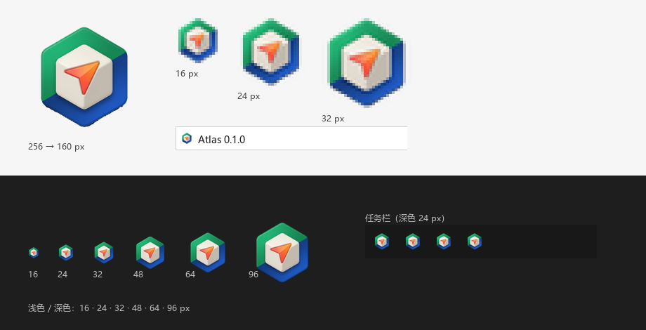

# Atlas Program Info

Atlas 的品牌与打包元数据（应用名、app id `org.atlas.Atlas`、图标、桌面文件、
AppStream 元数据、Windows 资源、man page、安装器脚本）。这里决定「装出来长什么样」，
与 `launcher/` 里的功能代码无关。

## Atlas 自己的

- 应用名 `Atlas`、app id `org.atlas.Atlas`、可执行文件名 `atlas`
- `atlas.rc.in` / `atlas.manifest.in` / `atlas.6.scd.in` / `win_install.nsi.in`
- `org.atlas.Atlas.{desktop,metainfo,mime}.*`、`org.atlas.Atlas*.svg`
- URL 协议 `atlas://`（与上游的 `prismlauncher://` 分开，两个启动器可共存）

## 沿用的（技术必需，不是耦合）

| 项 | 原因 |
| --- | --- |
| `Launcher_META_URL` = `meta.prismlauncher.org` | Atlas 不自建版本清单服务，改了就没有版本可装 |
| `org.prismlauncher.EntryPoint` | 游戏 jar 里的 Java 主类名，写死在 jar 内 |
| `x-prismlauncher-*`（packwiz） | 包格式规范的字段名 |

完整清单与「为什么不能改」见 `docs/atlas/07-发布清单.md` §7.1。

## 图标



应用图标现在是**位图母图**：`org.atlas.Atlas.png`（1024 RGBA，六边形瓦片 + 等距立方体 + 罗盘指针）。
它由 2048 的渲染稿去背、裁到内容、四周留 6% 后降采样而来；qrc 直接引用这份 PNG。
两版矢量稿都归档了，**不参与构建**：`archive/icon-2026-11-25/`（地图瓦片 + 立方体 + 罗盘，初版）与
`archive/icon-2026-11-26-letter-a/`（六边形 + 3D 字母 A，当晚短暂用过）。
当前母图的原始素材（两张 2048 候选）在 `archive/source-2026-11-26/`。

| 文件 | 谁在用 |
| --- | --- |
| `org.atlas.Atlas.png` | **原稿**（1024 RGBA，带 6% 留白与阴影）；生成 ico/icns 的大尺寸档与 `_256.png` |
| `org.atlas.Atlas.icon.png` | 由母图裁掉阴影、按实心边界铺满的 256 版；**编进 Qt 资源**（`atlas.qrc.in`），当窗口 / 关于页 / 快捷方式图标 |
| `atlas.ico` | `atlas.rc.in` 嵌进 `atlas.exe`（16/24/32/48/64/128/256，小于 256 用 BMP、256 用 PNG）；**16–48 用铺满母图**，64+ 用原母图 |
| `atlas.icns` | macOS 包（16–1024，画布 80% 留白） |
| `org.atlas.Atlas_256.png` | README 顶部与文档用的 256 px 位图 |
| `../launcher/resources/multimc/scalable/launcher.svg` | 主题占位图标，**仍是 11-25 那版**（见下方待办） |

改图之后**必须重新生成**二进制：

```bash
python genicons.py      # 当前只需 Pillow；若放了 org.atlas.Atlas.svg 才需要 Chromium
```

> `genicons.py` **矢量优先**：有 `org.atlas.Atlas.svg` 就无头渲染 1024 → 裁边补 6% → 回写 PNG 母图；
> 没有 SVG 就直接用现成的 `org.atlas.Atlas.png`。之后逐尺寸 LANCZOS 降采样，组装 ICO
> （<256 用 BMP、256 用 PNG）与 ICNS（7 槽 PNG）。生成结果提交进仓库，**构建本身不需要任何渲染工具**。
> 当前仓库没有 SVG，走的是 PNG 分支；去背 / 裁边是一次性处理，换图时按同样口径准备 1024 RGBA。
> **小尺寸的取舍**：16–48 px 用 `tight()` 裁掉阴影与留白（瓦片占约 95%），否则在白底任务栏里
> 只剩中间一小块；代价是这几档没有柔和阴影，这是有意的。
> 许可与署名见仓库根 `THIRD-PARTY-NOTICES.md` 的「品牌与图标」节。

## 待办

- `../launcher/resources/multimc/scalable/launcher.svg`（实例卡片占位图）**仍是 11-25 那版**：
  它在 qrc 里是 SVG，换成位图要改资源键名与调用点，单独一轮做（[04 P2 #37](../docs/atlas/04-进度与待办.md)）。
- `instance_icons.svg`（实例占位图）与 `org.atlas.Atlas.Social.svg`（社交预览图）仍是上游素材，
  署名保留在 `THIRD-PARTY-NOTICES.md`；换成自绘素材时一并替换。
